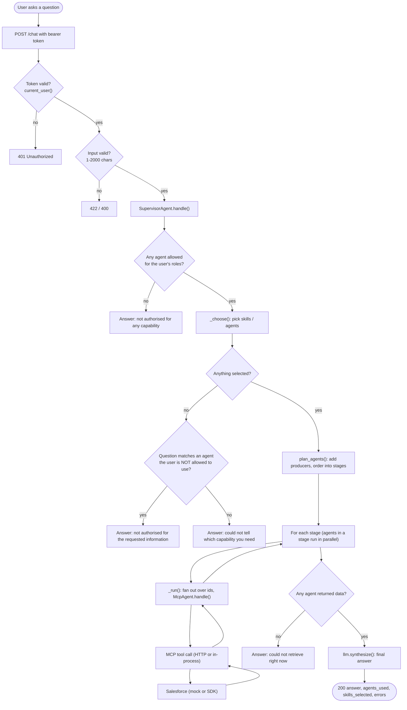
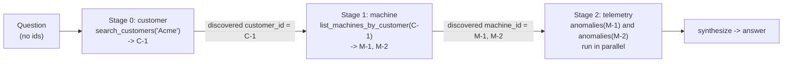
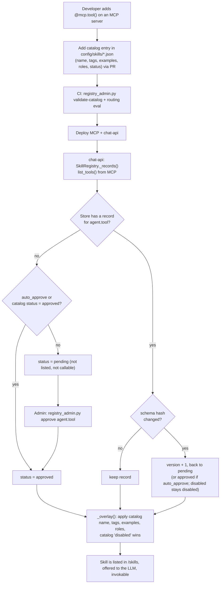

# Workflow and Functional Flow

How a request travels from the browser to Salesforce and back. Function-level detail of *how the agent is chosen* is in [03-query-routing-and-agent-selection.md](03-query-routing-and-agent-selection.md); message-by-message sequence diagrams are in [04-sequence-diagrams.md](04-sequence-diagrams.md).

---

## 1. End-to-end workflow (one chat question)



### Response contract

```json
{
  "answer": "string",
  "agents_used": ["customer", "machine", "telemetry"],
  "skills_selected": ["customer.search_customers", "machine.list_machines_by_customer"],
  "errors": { "telemetry": "unavailable" }
}
```

`errors` holds per-agent problems (`forbidden` or `unavailable`) while the rest of the answer is still returned (graceful degradation).

---

## 2. Functional flow by step

| # | Step | Function | Inputs -> output | Failure behaviour |
|---|---|---|---|---|
| 1 | Authenticate | [`current_user`](../src/presentation/api.py) -> `TokenValidator.validate` | bearer token -> `UserContext(user_id, tenant_id, roles)` | 401 |
| 2 | Validate input | `ChatRequest` (pydantic), [`HandleChatUseCase.execute`](../src/application/chat_service.py) | message -> trimmed message | 422 / 400 |
| 3 | Filter agents by role | [`AgentRegistry.allowed_for`](../src/application/registry.py) | ctx -> allowed agents | none allowed -> "not authorised" |
| 4 | Choose skills/agents | [`SupervisorAgent._choose`](../src/application/supervisor.py) | message, ctx, allowed -> agents, tools per agent, skill ids | selector failure -> fall back to routing strategy |
| 5 | Plan | [`plan_agents`](../src/application/planning.py) | selected, allowed, message -> ordered stages | - |
| 6 | Fan out | [`SupervisorAgent._run`](../src/application/supervisor.py), [`fanout_ids`](../src/application/planning.py) | agent, discovered ids -> text result | per-id failures tolerated if any succeed |
| 7 | Pick tool + args | [`McpAgent.handle`](../src/application/mcp_agent.py) -> `LLMProvider.pick_tool` | message, tools -> `ToolCall(name, args)` | no tool -> explanatory text |
| 8 | Call MCP | `McpToolClient.call_tool` (audited) | tool, args, ctx -> JSON | `AuthorizationError` -> `forbidden`; others -> `unavailable` |
| 9 | Harvest ids | [`find_ids`](../src/application/planning.py) | result text -> ids stored in `discovered` | - |
| 10 | Aggregate | `LLMProvider.synthesize` | parts per agent -> answer | - |

---

## 3. Functional flows for the three capabilities

### 3.1 MachineInfo
Tools on `mcp-machine`: `get_machine(machine_id)`, `list_machines_by_customer(customer_id)`. Role: `Machine.Read`.
Typical: "status of machine M-1" -> `machine.get_machine` -> `MachineRepository.get` -> Salesforce `Machine` object.

### 3.2 CustomerInfo
Tools on `mcp-customer`: `get_customer(customer_id)`, `search_customers(name)`. Role: `Customer.Read`.
Typical: "find customer named Acme" -> `customer.search_customers` -> Salesforce `Customer` search.

### 3.3 TelemetryInfo
Tools on `mcp-telemetry`: `latest_readings(machine_id, limit)`, `anomalies(machine_id)`. Role: `Telemetry.Read`. A reading is an anomaly when temperature > 80 C or vibration > 0.8 (`TelemetryReading.is_anomaly`).
Typical: "any anomalies on M-2" -> `telemetry.anomalies`.

### 3.4 Cross-domain (chained) example

"Show anomalies for all machines of customer named Acme" has no ids, so the planner chains the agents:



Each agent declares in [agents.yaml](../config/agents.yaml):

| Agent | `order` | `consumes` | `produces` |
|---|---|---|---|
| customer | 0 | `customer_id` | `customer_id` |
| machine | 1 | `machine_id`, `customer_id` | `machine_id` |
| telemetry | 2 | `machine_id` | - |

---

## 4. Skill lifecycle workflow (governance)



Only `approved` skills that the caller's roles permit are ever offered to the LLM or callable via `POST /skills/{id}/invoke`.

---

## 5. Error handling map

| Situation | Where handled | User-visible result |
|---|---|---|
| Missing/invalid token | `current_user` | 401 |
| Empty / too long message | pydantic, `HandleChatUseCase` | 422 / 400 |
| No allowed agents | `SupervisorAgent.handle` | 200 "not authorised to use any capability" |
| Question only matches a forbidden agent | `SupervisorAgent.handle` (re-runs strategy over all agents) | 200 "not authorised for the requested information" |
| Nothing matches | `SupervisorAgent.handle` | 200 "could not tell which capability you need" |
| LLM skill selector throws | `_choose` catches, logs, falls back | answer via keyword/skill/LLM routing |
| LLM returns bad JSON | `_loads` in Vertex adapter | treated as "no selection" -> fallback |
| MCP tool role check fails | `require_role` -> `AuthorizationError` | agent reported as `errors[agent] = "forbidden"` |
| MCP down / timeout | `HttpMcpClient` -> `UpstreamError` | `errors[agent] = "unavailable"`; other agents still answer |
| Every agent failed | `SupervisorAgent.handle` | 200 "could not retrieve that information right now" |
| `/skills/{id}/invoke` problems | `SkillRegistry.invoke` | 404 unknown/unapproved, 403 not permitted, 400 bad args, 502 MCP down |

---

## 6. Configuration switches that change the flow

| Setting | Values | Effect |
|---|---|---|
| `SKILL_SELECTION` | `llm` (default), `off` | `off` skips step "LLM picks skills"; routing strategy decides |
| `ROUTING` | `hybrid` (default), `keyword`, `skill`, `llm` | Fallback strategy used when selector returns nothing |
| `LLM_MODE` | `mock`, `vertex` | Heuristic stand-in vs Gemini |
| `EMBEDDER` / `SKILL_SHORTLIST_SIZE` | `hash`, `vertex`, `none` / 12 | Shortlist only when the catalog is larger than the size |
| `SKILL_MAX_STEPS` | 1-10 (default 4) | Cap on skills chosen per question |
| `MCP_TRANSPORT` | `inprocess`, `streamable_http` | MCP servers run inside chat-api, or as separate services |
| `REGISTRY_STORE` / `SKILLS_AUTO_APPROVE` | `yaml`/`firestore` / `true`/`false` | Prod requires `firestore` and `false` |
