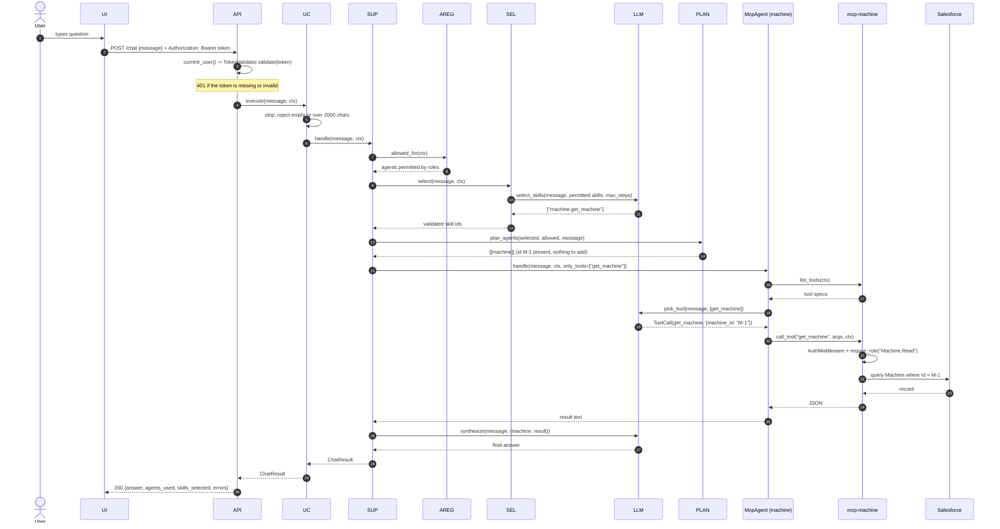
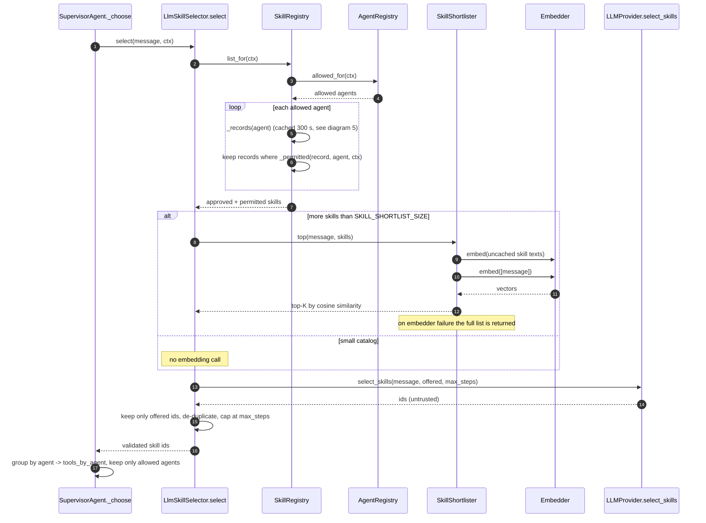
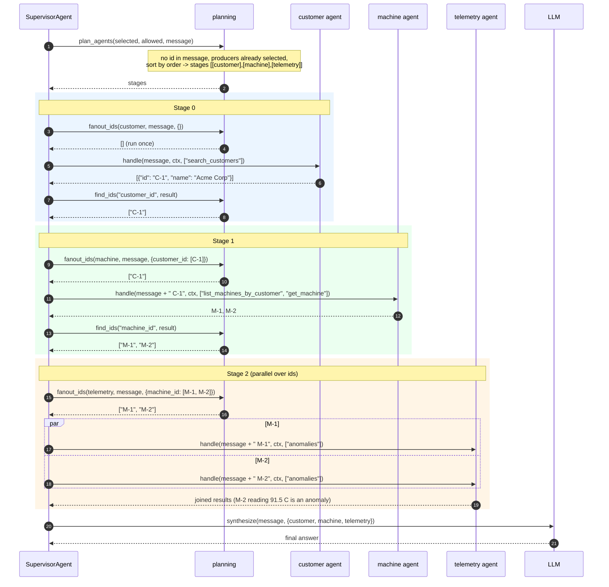
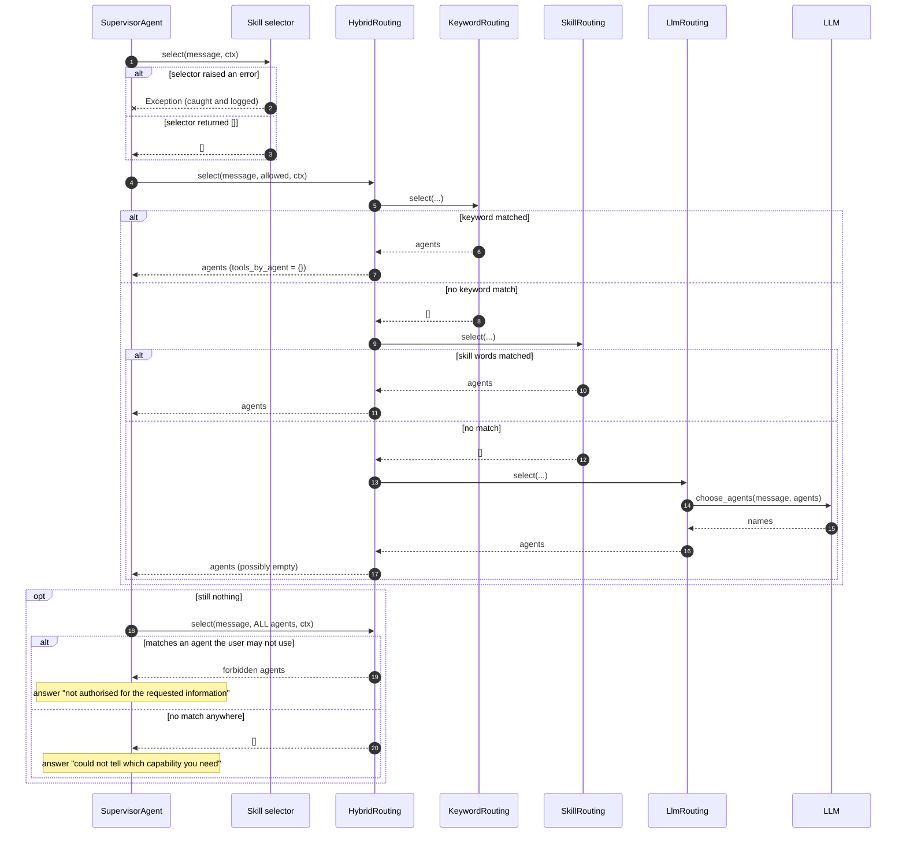
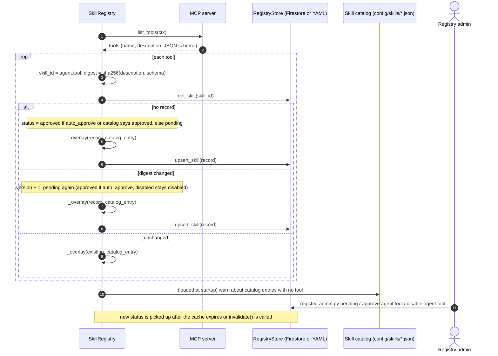
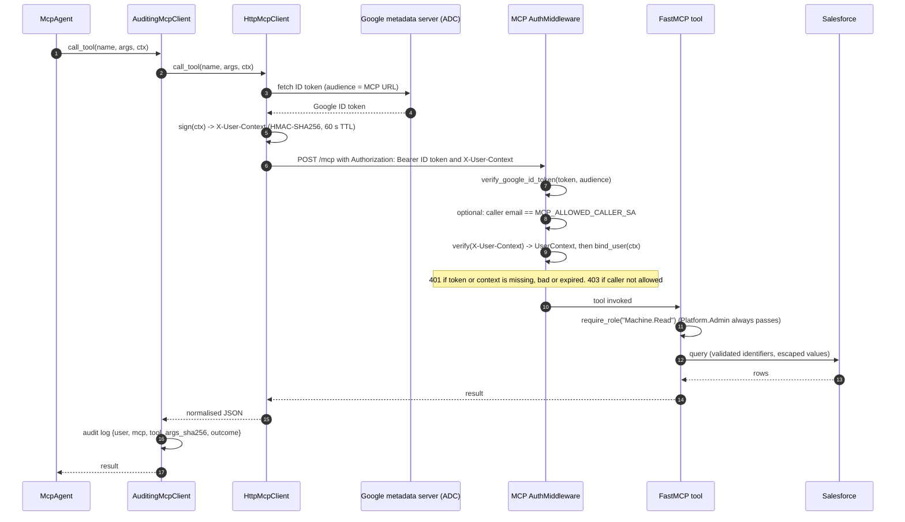
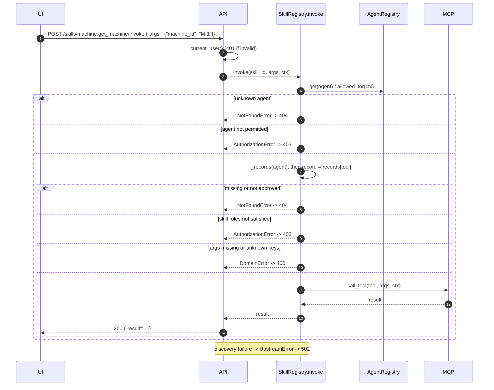
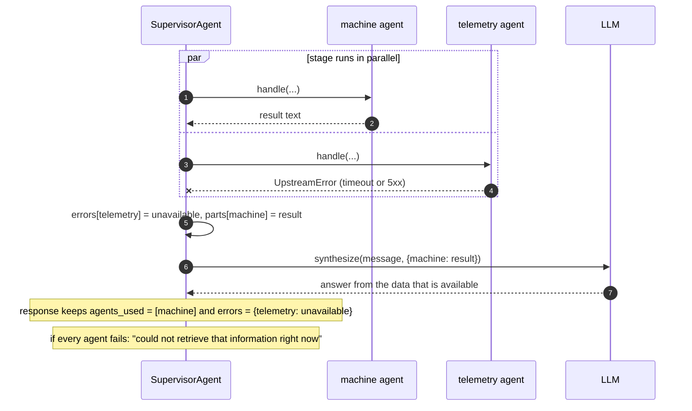
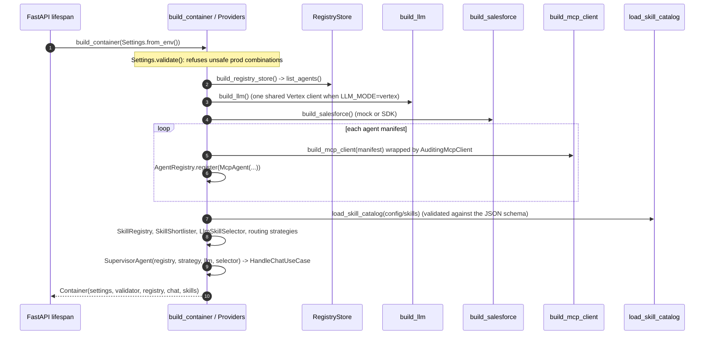

# Sequence Diagrams

All diagrams use [Mermaid](https://mermaid.js.org/) (rendered by GitHub and VS Code's Markdown preview). Function names match the code. Participants:

| Alias | Component |
|---|---|
| UI | Chat client |
| API | [presentation/api.py](../src/presentation/api.py) |
| UC | `HandleChatUseCase` |
| SUP | `SupervisorAgent` |
| AREG | `AgentRegistry` |
| SEL | `LlmSkillSelector` |
| SREG | `SkillRegistry` |
| SH | `SkillShortlister` |
| LLM | `LLMProvider` (Vertex Gemini or Mock) |
| PLAN | `plan_agents` / `fanout_ids` |
| AG | `McpAgent` |
| MCP | MCP client -> MCP server (`mcp-machine`, `mcp-customer`, `mcp-telemetry`) |
| SF | Salesforce (mock or SDK) |

---

## 1. End-to-end chat request (single skill)

Question: *"status of machine M-1"*.

---

## 2. Skill selection in detail

---

## 3. Chained multi-agent question

Question: *"anomalies for all machines of customer named Acme"* (no ids supplied).

---

## 4. Fallback routing (selector returned nothing)

---

## 5. Skill discovery, reconciliation and approval

Runs on first use of an agent and then every 300 seconds (`SkillRegistry._records`).

---

## 6. Service-to-service security handshake (chat-api to MCP)

---

## 7. Direct skill invocation API

`POST /skills/{skill_id}/invoke` bypasses routing but not security.

---

## 8. Partial failure (one MCP is down)

---

## 9. Application start-up (composition root)

Providers are lazy singletons; nothing is built until first use.

