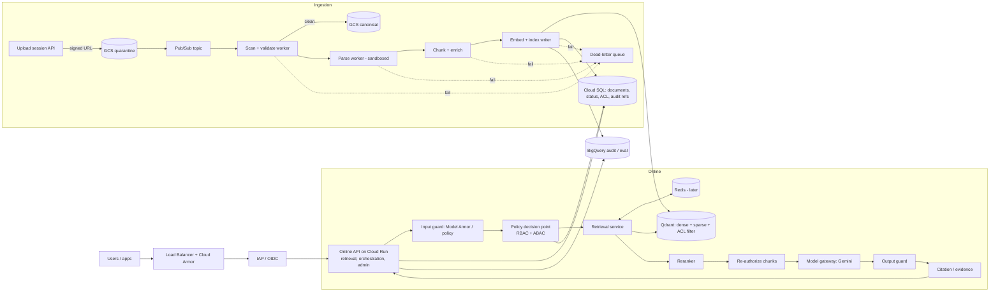

# RAG-GCP Target Architecture and Build Plan

Status: proposed. Based on the review of `enterprise_rag_architecture_comparison.md` and on what exists in this repository today. Items marked **[DECISION]** need an owner's sign-off (they become ADRs).

---

## 1. Where we are today

| Area | Today | Gap vs target |
|---|---|---|
| `backend/` | The only running code: FastAPI app, `POST /documents/upload` (sync, direct to GCS), GCP auth (WIF / local / impersonation), API-key auth, rate limit, request/response/validation models, tests (33) | No parsing, chunking, embedding, retrieval, generation, user identity, or async ingestion |
| `app/` (repo root) | Empty skeleton: `agents, api/{admin,auth,orchestration,retrieval}, services/{embeddings,ingestion,retrieval,storage}, orchestration, schemas, models, core` plus `infrastructure/terraform` | **Collides with `backend/app`** (this caused the "Could not import app.main" error). Two competing layouts |
| `portals/` | Three `package.json` stubs: admin, orchestration, retrieval | No code |
| Terraform | APIs, Artifact Registry, one documents bucket, one runtime service account, IAM for Vertex/GCS/Secret Manager. Local state file in the repo folder | No quarantine bucket, Pub/Sub topics, per-workload identities, database, vector store, remote state, environments |
| `rag-platform-sdk` (sibling repo) | Created with the package, README, changelog, `release.ps1` | Backend still imports its own `backend/sdk`; no `vendor/` wheel, tests not moved yet |
| Secrets/hygiene | Qdrant key moved to Secret Manager wiring | `wif-credentials.json` tracked in git, key in `.env.stage`, dummy key file, Dockerfile/dockerignore not hardened |

## 2. Architecture decisions (what we follow)

1. **One platform, hexagonal.** Domain and application code never import Google, Qdrant, Redis or FastAPI. Everything external sits behind a **port** with an **adapter**.
2. **Two planes, one codebase.**
   - *Online plane*: low-latency API (retrieval, orchestration, admin) on **Cloud Run**.
   - *Ingestion plane*: asynchronous workers driven by **Pub/Sub**, same image, different entrypoint, separate Cloud Run service and service account.
3. **Authorize before retrieval, and again after.** Policy filters are pushed into the search query; every selected chunk is re-checked before it reaches the prompt. Cache keys carry a policy fingerprint.
4. **Start with the fewest data stores that meet the need** **[DECISION ADR-002]**:

   | Concern | v1 choice | Why | Later option |
   |---|---|---|---|
   | Vectors + sparse/BM25-style search + ACL filters | **Qdrant** (dense + sparse vectors, payload filters) | Already in this project; one store gives hybrid search | Vertex AI Vector Search / AlloyDB AI behind `VectorStorePort` |
   | Control metadata, document status, ACLs, audit index | **Cloud SQL PostgreSQL** | Transactions, SQL governance | AlloyDB |
   | Files | **GCS**: `quarantine` and `canonical` buckets | Isolation of untrusted files | Retention locks, CMEK |
   | Events | **Pub/Sub** + DLQ | Durable, retryable ingestion | Workflows for complex sagas |
   | Cache | **Memorystore Redis**, introduced only after latency is measured | Avoid premature complexity | |
   | Audit/eval warehouse | **BigQuery** | Evaluation and audit analytics | |
5. **Identity.** People: corporate OIDC through **IAP / Workforce Identity Federation**; the API validates the JWT (`iss`, `aud`, signature, expiry). Workloads: **WIF, no JSON keys**. The shared `X-API-Key` stays only for service-to-service clients until OIDC service identities replace it.
6. **Model access** only through a `ModelGatewayPort`: allowlisted models/regions, **Model Armor** on input and output, no raw prompt/response logging by default.
7. **Everything cross-cutting lives in the SDK** (auth helpers, logging, middleware, errors, schemas, probes). Domain logic stays in this repo.

## 3. Target logical architecture



Differences from the reviewed document: the input guard comes first and the output guard last; the policy decision is checked before search **and** after rerank; one hybrid store for v1 instead of three.

## 4. Target repository structure

Single package name **`app`** inside `backend/`; the empty root `app/` skeleton is retired. Layers follow the dependency rule (inner layers never import outer ones).

```text
RAG-GCP/
├── backend/
│   ├── app/
│   │   ├── domain/                    # entities, value objects, policy rules, domain errors (pure Python)
│   │   │   ├── document.py            # Document, DocumentVersion, IngestionStatus
│   │   │   ├── chunk.py               # Chunk (+ ACL, classification, versions)
│   │   │   ├── principal.py           # Principal (user/service, groups, attributes)
│   │   │   └── errors.py
│   │   ├── application/
│   │   │   ├── ports/                 # Protocols: DocumentParserPort, ChunkingStrategyPort, EmbeddingPort,
│   │   │   │                          #   VectorStorePort, RerankerPort, PolicyDecisionPort, ModelGatewayPort,
│   │   │   │                          #   ObjectStorePort, MetadataRepoPort, EventBusPort, CachePort, AuditPort
│   │   │   ├── ingest/                # use cases: create_upload_session, scan, parse, chunk, index
│   │   │   ├── retrieve/              # use case: hybrid retrieve -> fuse -> rerank -> reauthorize
│   │   │   ├── generate/              # use case: grounded answer with citations / abstain
│   │   │   └── admin/                 # knowledge bases, agents, templates, release gates
│   │   ├── adapters/                  # the ONLY place that imports cloud/vendor SDKs
│   │   │   ├── storage/               # GCS (today: app/services/storage/storage_service.py)
│   │   │   ├── identity/              # GCP credentials binding (today: app/auth/gcp.py), OIDC verifier
│   │   │   ├── policy/                # RBAC+ABAC engine (OPA/Cedar/in-process)
│   │   │   ├── parsers/               # pdf, docx, txt, ocr
│   │   │   ├── embeddings/            # Vertex gemini-embedding
│   │   │   ├── vectorstores/          # qdrant (+ duckdb for local tests)
│   │   │   ├── rerankers/
│   │   │   ├── models/                # Gemini behind model gateway, Model Armor
│   │   │   ├── events/                # Pub/Sub
│   │   │   ├── metadata/              # Cloud SQL repositories
│   │   │   ├── cache/                 # Redis
│   │   │   └── audit/                 # BigQuery / structured audit log
│   │   ├── interfaces/
│   │   │   ├── api/
│   │   │   │   ├── v1/{documents,retrieval,orchestration,admin}.py   # routers (today: app/api/documents)
│   │   │   │   └── models/{request,response}/                       # today: app/models (+ validations/)
│   │   │   ├── events/                # Pub/Sub push handlers: worker entrypoints per stage
│   │   │   └── cli/
│   │   └── bootstrap/                 # settings (today app/core/config.py), wiring/DI, main.py, worker_main.py
│   ├── tests/{unit,contract,integration,architecture}/
│   ├── Dockerfile                     # one image; API and worker differ by command
│   ├── vendor/                        # rag_platform_sdk-*.whl (built from the SDK repo)
│   └── requirements.txt
├── portals/
│   ├── admin-portal/                  # agents, KBs, policies, release
│   ├── orchestration-portal/          # chat / SSE client
│   └── retrieval-portal/              # search, chunk inspection, curator
├── contracts/                         # OpenAPI, AsyncAPI, event schemas (generated clients for portals)
├── infra/
│   └── terraform/{modules,envs/{dev,stage,prod}}      # remote state in GCS; today: app/infrastructure/terraform
├── quality/                           # golden question sets, red-team prompts, load tests
├── docs/{TARGET_ARCHITECTURE.md,adr/}
└── scripts/
```

Architecture test (runs in CI): `domain` imports nothing outside itself; `application` imports only `domain`; only `adapters` import `google.*`, `qdrant_client`, `redis`; `interfaces` import `application`.

Mapping of existing code: `app/api/documents/documents.py` → `interfaces/api/v1/documents.py`; `app/models/request|response` → `interfaces/api/models/...` (same validation-per-request convention); `app/services/storage` → `adapters/storage`; `app/auth/gcp.py` → `adapters/identity`; `app/core/config.py` → `bootstrap/config.py`; `app/main.py` → `bootstrap/main.py`; rate limit, API-key, logging, middleware, errors, health stay in the SDK.

## 5. Step-by-step plan

Each step is a mergeable, tested increment. Do them in order.

### Step 0. Housekeeping (days)
- Make the backend consume the SDK as a built wheel: run `rag-platform-sdk/scripts/release.ps1`, add `--find-links ./vendor` and `rag-platform-sdk>=0.1,<0.2` to `requirements.txt`, remove `backend/sdk`, move the SDK tests to the SDK repo, update the Dockerfile to copy `vendor/` first.
- Retire the root `app/` skeleton (the name collision) and move `app/infrastructure/terraform` to `infra/terraform`; use a GCS remote backend for Terraform state.
- `git rm --cached backend/secrets/wif-credentials.json`; remove the key from `.env.stage`; delete the dummy key file; add `--proxy-headers` to uvicorn; exclude `secrets/`, `tests/` and `.env*` from the image.
- Done when: clean checkout builds and tests pass, `git ls-files` shows no secrets.

### Step 1. Hexagonal skeleton and guardrails
- Create the layer folders and the ports listed in section 4, even if adapters are stubs.
- Move current code to the mapped locations; keep behaviour identical (existing tests stay green).
- Add the architecture test and Ruff, mypy and Bandit to CI.
- Done when: the architecture test fails if a layer rule is broken.

### Step 2. Identity and authorization
- Domain `Principal`; OIDC JWT verification dependency (replaces user-facing API key); `PolicyDecisionPort` with RBAC roles (Platform Admin, Knowledge Steward, Data Owner, End User, Auditor, ...) and ABAC attributes (tenant, groups, classification, region, purpose).
- Cloud SQL tables: tenants, knowledge bases, documents, document ACLs, audit records.
- Every decision writes an audit record (decision ID, policy version, reason).
- Done when: automated cross-tenant and cross-group negative tests pass.

### Step 3. Asynchronous ingestion
- `POST /v1/documents/upload-sessions` returns a signed GCS URL into the **quarantine** bucket; keep the current direct upload only for dev and small files.
- Pub/Sub event on object finalize → scan/validate worker (content type by magic bytes, size/page limits, malware/DLP scan) → copy to **canonical** bucket; failures go to the DLQ.
- Document status model (`UPLOADED → SCANNED → PARSED → CHUNKED → INDEXED / FAILED`), idempotency keys (`tenant_id, document_id, content_hash, recipe_version`), retry with backoff.
- Terraform: quarantine and canonical buckets, topics, subscriptions, DLQ, a separate worker service account with least privilege.
- Done when: a 50 MB PDF is processed end to end, a poisoned file lands in the DLQ, replaying an event creates no duplicates.

### Step 4. Parsing and chunking
- `DocumentParserPort` adapters (pdf, docx, txt first; OCR for scans) run in a sandboxed worker (no outbound network, CPU/memory/time limits).
- Canonical document model keeping page/section/table coordinates; versioned chunk **recipes** (heading-aware parent-child for policies and manuals, table-aware, FAQ).
- Every chunk carries: `tenant_id, kb_id, document_id, document_version, chunk_id, parent_id, parser_version, recipe_version, embedding_model, index_version, content_hash, ACL, classification, source_coordinates`.
- Done when: recipes are covered by golden-file tests and chunk coordinates round-trip to the source page.

### Step 5. Embeddings and indexing
- Vertex AI embeddings adapter (batched, retried); Qdrant adapter writing dense + sparse vectors with payload ACL fields; index versions with atomic promote and rollback.
- Done when: re-indexing a document replaces old vectors atomically and a deleted or reclassified document disappears from search.

### Step 6. Retrieval service
- Pipeline: normalize query → resolve authorized KBs → hybrid search with policy filters pushed down → fuse (weighted RRF) → dedupe → rerank → re-authorize each chunk → expand parents → stable citation IDs.
- `POST /v1/retrieval/search` with request/response models and validations in the same per-request layout.
- Done when: the golden set reaches the agreed Recall@20 / nDCG@10 baseline and there is zero cross-tenant leakage in tests.

### Step 7. Generation and orchestration
- `ModelGatewayPort` (Gemini), Model Armor on input and output, grounded-answer prompt that treats retrieved text as untrusted data, abstain when evidence is thin, SSE streaming, citations returned with the answer.
- Bounded query decomposition and agent loops; tool calls need schema, timeout, authorization and idempotency.
- Done when: prompt-injection red-team set passes and answers cite only authorized sources.

### Step 8. Observability and SRE
- OpenTelemetry across API, workers, policy, retrieval, model; metrics for queue age, parser failures, cache hit, token counts, latency; SLO dashboards and burn-rate alerts. Request-id/logging already come from the SDK.
- Done when: a single trace id follows an upload from API to indexed chunk.

### Step 9. Caching (only after measuring)
- Redis namespaces for identity/policy decisions, query embeddings and retrieval results; keys include tenant, ACL/policy fingerprint, index and model versions; event-based invalidation. Final-answer caching stays off for sensitive data.

### Step 10. Portals
- Generate TypeScript clients from OpenAPI in `contracts/`. Build retrieval portal (search + chunk inspection) first, then orchestration (chat/SSE), then admin (KBs, agents, policies, release).

### Step 11. Platform hardening
- Terraform modules and `dev/stage/prod` environments; separate projects where policy requires; VPC Service Controls, private networking, CMEK where required, Binary Authorization, SBOM, signed images, vulnerability scanning in CI.

### Step 12. Evaluation gates and resilience
- Release gates: golden-set retrieval, groundedness/citation, safety, load/soak, failure-injection; canary rollout; restore test and index rebuild from canonical GCS as the disaster-recovery path; start RPO ≤ 15 min, RTO ≤ 4 h and tighten by tier.

## 6. SDK boundary

| Belongs in `rag-platform-sdk` | Belongs in this repo |
|---|---|
| GCP credential engine, API-key and JWT verification helpers | Domain, ports, use cases, adapters |
| Logging + request ids, middleware, error handling, rate limiter, health probes, `create_base_app` | Routers, request/response models, validations |
| Generic schemas (`ApiResponse`, `Page`, `ErrorResponse`) | Policy rules and RAG-specific schemas |
| Version guard (`require_sdk_version`) | Settings and wiring |

Add to the SDK when a second service needs it: OpenTelemetry setup, a Pub/Sub push-handler helper (verify OIDC, ack/nack semantics), and a retry/circuit-breaker utility. Bump the SDK minor version for each.

## 7. Decisions needed from you

1. **ADR-002**: Qdrant as the v1 hybrid store (recommended) vs Vertex AI Vector Search vs AlloyDB. Where does Qdrant run: Qdrant Cloud or GKE?
2. **Identity**: which IdP (Entra, Okta, Google Workspace) and which claims carry tenant and groups?
3. **Tenancy**: shared index with filters (recommended to start) vs index per tenant.
4. **Document scope for v1**: PDF, DOCX, TXT only, or also scans/OCR, slides, tables, code?
5. **Scale and data class**: expected documents, QPS, regions, and whether CMEK / VPC-SC are mandatory now.
6. **RAGFlow**: benchmark only (recommended) or integrate as an isolated backend?

## 8. ADRs to write first
ADR-001 hexagonal boundaries and SDK contract; ADR-002 vector/lexical store; ADR-003 RBAC+ABAC and enforcement points; ADR-004 canonical document and chunk schema; ADR-005 parser sandbox and untrusted-file controls; ADR-006 model allowlist, data residency and logging policy. Cache partitioning, SLO/RTO, RAGFlow policy and evaluation gates can follow in Steps 8-12.


---

## 9. Retrieval specification

Applies to Step 6 and Step 7. Every numeric value is a **starting hypothesis** to be calibrated against the golden set (section 9.6).

### 9.1 Query handling
1. Normalize (Unicode NFKC, trim) and detect language; reject or truncate over-long input.
2. Input guard (Model Armor / policy), then resolve the caller's authorized knowledge bases.
3. Classify intent: `lookup` (exact identifiers, part numbers, clause numbers), `question`, `multi-part`. `lookup` weights sparse search higher.
4. Query rewriting is **bounded**: at most one rewrite plus at most 3 sub-queries, only when the `multi-part` classifier fires, with a 300 ms budget and a fallback to the original query.

### 9.2 Embeddings
- Documents use task type `RETRIEVAL_DOCUMENT`, queries use `RETRIEVAL_QUERY`. Never mix.
- Embedding model name, version and dimension are stored on every chunk and on the index. A query is only run against an index built with the same model and dimension; a mismatch fails closed with an alert.
- Embed the **chunk text plus its title path** (document title > section > subsection), not the bare chunk.

### 9.3 Search (hybrid)
- **Dense:** top 50 from Qdrant by cosine similarity.
- **Sparse:** top 50 from Qdrant sparse vectors. **Validate before relying on it**: it must behave like BM25 (term frequency plus inverse-document-frequency weighting, or a learned sparse model). Confirm the feature on the deployed Qdrant version and compare against Elasticsearch/OpenSearch BM25 on the golden set; if it loses clearly, record that in ADR-002.
- **Filters are part of the query**, never applied afterwards: `tenant_id`, `kb_id IN authorized`, ACL groups, classification ceiling, region, `effective_from <= now < effective_to`, `index_version = promoted`.
- Dense and sparse run concurrently with a per-branch timeout (default 400 ms). If one branch fails or times out, continue with the other and record `degraded=true` in the trace.

### 9.4 Fusion, rerank, selection
1. **Fusion:** weighted Reciprocal Rank Fusion (default `k=60`, weights dense 1.0 / sparse 1.0, sparse 1.5 for `lookup`). Keep calibrated-score fusion as an alternative profile.
2. **Dedupe** by `parent_id` / `content_hash`.
3. **Rerank** the top 50 fused candidates with a cross-encoder (`RerankerPort`; candidates: Vertex AI ranking API or a hosted cross-encoder). Hard timeout 350 ms; on timeout use fused order and set `rerank_skipped=true`.
4. **Diversity:** maximal marginal relevance (MMR, lambda 0.7) so one document cannot fill the whole context.
5. **Select** 5-12 evidence units within the token budget; expand children to parents when the parent is within budget.
6. **Re-authorize** every selected chunk with the policy decision point (fresh, uncached for high-risk classifications), drop any chunk that fails.
7. **Relevance threshold:** if the best reranked score is below the calibrated threshold, or fewer than N evidence units remain, return an *insufficient evidence* result and let generation abstain.
8. Assign stable citation IDs (`document_id`, `document_version`, page/section coordinates).

### 9.5 Recency, language, versions
- Prefer documents inside their effective-date window; an optional freshness boost is a profile setting, not a default.
- Multilingual: same embedding model for all languages; the sparse branch uses a language-aware analyzer, so keep `language` as chunk metadata and filter or boost by it per profile.
- Retrieval profiles (weights, top-k, rerank on/off, thresholds, MMR) are versioned config owned by the Knowledge Steward and promoted through the same release gates as code.

### 9.6 Evaluation (a Step 6 prerequisite)
- **Golden set:** 100-300 questions per knowledge base to start, each with the expected supporting chunks/pages, written or reviewed by the data owner. Include exact-identifier, multi-part, multilingual, and no-answer questions.
- **Metrics:** Recall@20, nDCG@10, MRR, citation correctness, abstention accuracy, p50/p95 latency per stage.
- **Starting gates (calibrate, do not treat as claims):** Recall@20 ≥ 0.90, nDCG@10 ≥ 0.80, citation correctness ≥ 0.95, zero cross-tenant results.
- **Ablations are required:** dense only vs sparse only vs hybrid, with and without rerank, with and without query rewriting. A component stays only if it improves the metrics for its latency cost.
- The golden set has a named owner and is versioned in `quality/`; every retrieval-profile or recipe change must pass it before promotion.

---

## 10. Caching design

Rule zero: **no cache is added until a latency or cost baseline shows it is needed**, and no cache may ever return data the caller is not authorized to see.

### 10.1 Layers

| Layer | Key (all include `tenant_id`) | Value | TTL (start) | Invalidated by |
|---|---|---|---|---|
| L0 In-process | JWKS keys, settings | Public keys | until rotation | restart / refresh |
| Identity / groups | `subject`, IdP group version | Group memberships | 1-5 min | IdP group event; short TTL |
| Policy decision | `subject_fingerprint`, action, resource attrs, `policy_version` | allow/deny + reason | 30-120 s | policy or entitlement change event |
| KB metadata | `kb_id`, schema version | KB config, retrieval profile | 5-15 min | admin update event |
| Query embedding | hash(normalized text), language, model + version, task type | vector | 1-24 h | model/version change |
| Retrieval result | hash(query), authorized-KB set, **ACL/policy fingerprint**, `index_version`, profile version | chunk IDs + scores (no text) | 30-300 s | `index_version` bump, document/ACL events |
| Rerank output | hash of candidate IDs, reranker version | ordered IDs | 5-30 min | reranker version change |
| Final answer | hash(prompt + history), evidence hashes, model/prompt/policy versions, subject scope | answer | **off by default**; 30-120 s only for public/low-risk FAQ KBs | any component version change |

Ingestion also caches embeddings by `content_hash + model + version` so re-indexing unchanged text is free (stored in the metadata DB or object store, not Redis).

### 10.2 Rules
- Store **identifiers and scores, not document text**, wherever possible; re-fetch text after re-authorization.
- Authorization denials are cached only for a few seconds; entitlement changes must not wait on a long TTL.
- Invalidation is event-driven (Pub/Sub topic `cache-invalidation`) published by the service that owns the change: document, ACL, index promotion, policy, prompt, model, retrieval profile.
- **Request coalescing** (single-flight) per key to prevent stampedes; add TTL jitter (±10%).
- **Fail open for performance caches, fail closed for authorization caches** when Redis is unavailable: embeddings/retrieval fall back to computing; policy decisions fall back to the PDP, and if the PDP is unavailable the request is denied.
- Separate Redis namespaces (or instances for sensitive classes), TLS and IAM auth, memory limits with an eviction policy, no persistence of sensitive values unless required.
- Metrics per layer: hit ratio, stale-hit count, invalidation lag, saved latency, saved cost. A layer whose hit ratio or saved latency is poor is removed.

### 10.3 Tests
ACL changed while the cache is warm; document deleted or reclassified while cached; index promoted mid-flight; Redis down; two tenants issuing the same query text; poisoned cache key collision.

---

## 11. SOLID and design rules (checklist for every pull request)

| Principle | Rule in this codebase | How it is enforced |
|---|---|---|
| **S**ingle responsibility | One use case per module (`create_upload_session`, `index_document`, `hybrid_retrieve`); routers only translate HTTP; adapters only translate to one vendor | Code review checklist; module-size guideline |
| **O**pen/closed | New parser, chunker, reranker, vector store or cache = a new adapter plus a registry/config entry, with no edits to use cases. The registry is an explicit allowlist, never arbitrary imports | Adapter registry; contract tests |
| **L**iskov | Every adapter must pass the shared **contract test suite** for its port (for example the same tests run against Qdrant, an in-memory fake and any future store: filter semantics, pagination, error types, timeouts) | `tests/contract/<port>/` run against all adapters in CI |
| **I**nterface segregation | Small, role-based ports. Split rather than extend: `VectorSearchPort` (read) vs `VectorIndexPort` (write/promote); `ObjectReadPort` vs `ObjectWritePort`; `PolicyDecisionPort` vs `PolicyAdminPort`. Create a port only when a step needs it (not all 12 up front) | Review: any port with methods a given caller does not use must be split |
| **D**ependency inversion | `domain` and `application` depend on ports only; adapters are wired in `bootstrap`; use cases receive ports through constructors | **Architecture test** (import-linter or pytest) in CI |

Additional rules:
- Domain objects are plain Python (immutable dataclasses/value objects where practical); Pydantic models live at the HTTP and event boundaries only, and are mapped to domain objects.
- Typed error taxonomy (`AppError` subclasses from the SDK plus domain errors); no vendor exceptions cross an adapter boundary.
- Timeouts, retries and cancellation are owned by adapters, with a per-call deadline passed in from the use case.
- No global singletons inside domain/application code; cached clients live in `bootstrap`/adapters.
- Strategy objects (parser, chunker, retrieval profile) are selected by versioned configuration so a change is traceable and reversible.
- Test pyramid: unit (domain/use cases with fakes), contract (adapters), integration (emulators/test projects), architecture, and evaluation (golden sets).

### Adjustments to earlier sections
- **Step 1:** create ports incrementally and split read/write ports as above; add the contract-test harness together with the first two adapters (the GCS adapter and an in-memory fake).
- **Step 6:** the evaluation harness and golden set (9.6) must exist **before** retrieval is implemented, and the ablations decide which components ship.
- **Step 9:** caching starts only with the layers that the baseline shows are needed; section 10 is the specification.

---

## 12. Capacity, quotas and cost

All figures below are **sizing methods and starting limits**, not measurements. Phase 0 replaces them with load-test results.

### 12.1 Sizing method
- **Vector memory** ≈ `chunks × dimensions × 4 bytes × 1.5` (index overhead) for dense vectors, plus sparse vectors and payload. Example: 5 M chunks × 768 dims × 4 B × 1.5 ≈ 23 GB before payload; plan RAM for the whole hot index plus headroom. Use quantization only after recall is re-measured.
- **Chunks** ≈ `documents × average pages × chunks per page` (start with 2-4 for prose, more for tables).
- **Ingestion throughput** = pages per second per worker × workers; size the queue so the oldest-message age stays within the ingestion SLO.
- **Online capacity** = peak QPS × per-request CPU time ÷ target CPU utilization; set Cloud Run `max-instances`, concurrency and CPU from load tests, not defaults. The current manifest (`maxScale: 2`, 512 Mi) is a development value.

### 12.2 Quotas and abuse control (per tenant and per principal)
| Limit | Start value | Enforced at |
|---|---|---|
| Requests per minute | configurable (SDK rate limiter today; gateway/Cloud Armor for global limits) | API gateway + service |
| Concurrent ingestion jobs | 5-20 | Ingestion scheduler |
| Max upload size / pages | 10 MB today; raise per file type after parser tests | Upload session API |
| LLM tokens per day | per tenant budget | Model gateway |
| Top-k / context tokens | capped by retrieval profile | Retrieval service |
| Agent loop steps | hard cap (for example 5) | Orchestrator |

### 12.3 Cost controls
- Labels on every resource (`tenant`, `env`, `component`) and a BigQuery billing export.
- Metrics: **cost per successful answer**, tokens per answer, embedding cost per 1 000 pages, rerank calls per query.
- Budget alerts per environment; model gateway refuses requests when a tenant budget is exhausted (clear error, not a silent failure).
- Prefer batch embedding, content-hash reuse (no re-embedding of unchanged text) and cache layers that the baseline proves worthwhile.

---

## 13. Reliability and disaster recovery

### 13.1 Service tiers
| Tier | Scope | Availability | RPO | RTO |
|---|---|---|---|---|
| Standard (start) | Single region, multi-zone | 99.9% | ≤ 15 min | ≤ 4 h |
| Critical (later) | Multi-region read path, replicated stores | 99.95% | ≤ 5 min | ≤ 1 h |

Multi-region is a **decision with criteria**, not a default: adopt it only when the business tier requires it and the cost is approved (**ADR-008**).

### 13.2 Backups and recovery per component
| Component | Protection | Recovery path |
|---|---|---|
| GCS canonical bucket | Object versioning, retention lock where required, cross-region copy for critical tier | Restore objects; **source of truth for rebuilds** |
| Cloud SQL | HA (regional), automated backups, point-in-time recovery | PITR restore, then reconcile with GCS |
| Qdrant | Replication factor ≥ 2, scheduled snapshots to GCS | Restore snapshot, or **rebuild the index from canonical GCS** by replaying ingestion events at the recorded `recipe_version` |
| Redis | Not a source of truth, can be flushed | Cold start with reduced performance |
| BigQuery audit | Time-travel, dataset retention, separate security project | Restore from table snapshot |
| Terraform state | Remote GCS backend with versioning and locking | Restore previous state version |

### 13.3 Resilience patterns (owned by adapters, configured per call)
Timeouts on every external call, retry with jitter only for idempotent operations, circuit breakers and bulkheads around Vertex AI, Qdrant, Redis and the policy service, load shedding (reject early with 429/503 and `Retry-After`) when queues or latency exceed thresholds, and graceful degradation (skip rerank, drop to one search branch) recorded in the trace.

### 13.4 Proof
Restore test every quarter (Cloud SQL PITR, Qdrant snapshot, full index rebuild from GCS), an annual regional failover exercise for the critical tier, and failure-injection tests in CI/staging: provider 429/5xx, Redis down, policy service down (must **fail closed**), partial index writes, queue backlog.

---

## 14. Qdrant operations

| Topic | Decision to record in ADR-002 |
|---|---|
| Hosting | Qdrant Cloud on GCP (managed, lowest operations) or self-managed on GKE (more control, more work). Do not run a single un-replicated instance in production |
| Availability | Distributed mode with replication factor ≥ 2 across zones; resource requests/limits and pod disruption budgets if on GKE |
| Networking | Private connectivity only (Private Service Connect or private VPC); no public endpoint; TLS in transit |
| Authentication | API key from Secret Manager (already wired as `QDRANT_API_KEY`); rotate on a schedule; never in files or images |
| Collections | One collection per `index_version`; a stable **alias** points to the promoted version; promotion = atomic alias swap, rollback = swap back |
| Payload | Index the payload fields used in filters (`tenant_id`, `kb_id`, `acl_groups`, `classification`, `effective_from/to`, `index_version`) so filtering stays fast |
| Backup | Scheduled snapshots to GCS; snapshots expire according to the retention policy (section 15) |
| Upgrades | Pin the version, test in staging with the golden set, roll node by node; keep the previous collection until the new one is validated |
| Monitoring | Latency per query type, memory, segment/optimizer state, replication lag, disk usage; alert before memory exhaustion |

---

## 15. Data lifecycle: retention, deletion, legal hold, reclassification

### 15.1 Policies
Every document has a retention class and classification. A **legal hold** blocks deletion regardless of retention. These are stored in the metadata database and copied to chunk payloads so the search layer can honour them.

### 15.2 Deletion / erasure (end to end)
A deletion request creates a `DeletionJob` (idempotent, auditable) that must complete **every** step; the job is only `COMPLETED` when all succeed, otherwise it retries and alerts.

1. Mark the document `PENDING_DELETION` immediately; retrieval filters it out at once.
2. Delete chunks from Qdrant (all index versions).
3. Delete derived artifacts and objects in the canonical and quarantine buckets (including old object versions).
4. Delete or anonymize metadata rows; keep a minimal tombstone (ID, hash, time, actor, reason) for audit.
5. Publish cache invalidation events; purge related cache entries.
6. Record the deletion in the audit log (without content).
7. Backups, snapshots and BigQuery data expire on their retention schedule; document that residual copies exist until then, or use cryptographic erasure (per-tenant or per-data-class CMEK key destruction) where policy demands immediate erasure.
8. Verification job: search and fetch attempts for the deleted document must return nothing.

### 15.3 Reclassification and ACL change
Updating classification or ACLs rewrites chunk payloads (no re-embedding needed), bumps a policy/ACL version, emits invalidation events, and is covered by the "ACL mutated while cache warm" negative test.

### 15.4 Log hygiene
Prompts, retrieved text and model output are not logged by default; diagnostic capture is sampled, redacted, encrypted, access-controlled and expires automatically.

---

## 16. Schema, index and model migrations

| Change | Approach |
|---|---|
| Database schema (Cloud SQL) | Versioned migrations (for example Alembic), **expand/contract**: add nullable columns, deploy code that writes both, backfill, switch reads, remove old columns later. Never a breaking change in one release |
| New chunk recipe or parser version | Build a **new index version** from canonical GCS in the background; compare against the golden set; promote by alias swap; keep the old version for rollback |
| New embedding model or dimension | Always a new index version (vectors from different models are not comparable). Dual-read in shadow to compare quality and latency, then cut over. Queries are blocked from mismatched indexes |
| Payload/metadata field added | Backfill payload with batch jobs; filters ignore the field until backfill completes |
| API changes | Versioned routes (`/v1`), additive changes only within a version, deprecation window and contract tests against generated clients |
| Event schemas | Versioned AsyncAPI schemas with backward-compatible changes; consumers tolerate unknown fields |
| SDK | Semantic versioning with `require_sdk_version` guard (already implemented); upgrade app and SDK in separate pull requests |

Every migration has a rollback step that is tested in staging.

---

## 17. Threat model, incident readiness and compliance

### 17.1 Trust boundaries and top threats (starting STRIDE-style view; the formal model is a Phase 0 deliverable)
| Boundary / asset | Threat | Mitigation in this architecture |
|---|---|---|
| Internet → API | Spoofing, abuse, scraping | Cloud Armor, OIDC/IAP, rate limits, quotas |
| Tenant A → Tenant B data | Information disclosure | Mandatory policy filters in the query, per-chunk re-authorization, tenant in every cache key, cross-tenant negative tests on every release |
| Uploaded files | Malware, archive bombs, parser exploits | Quarantine bucket, content-type by magic bytes, scanning, sandboxed parsers without network, size/page limits |
| Retrieved text → prompt | **Prompt injection** | Treat retrieved text as untrusted data, delimiters, no instruction inheritance, tool allowlists, output guard, red-team suite |
| Model provider | Data exfiltration, residency breach | Model/region allowlist, private access, VPC Service Controls, no raw logging |
| Secrets and keys | Leakage | Secret Manager, WIF (no JSON keys), rotation, secret scanning in CI |
| Supply chain | Malicious dependency/image | Pinned dependencies, SBOM, signed images, vulnerability scanning, Binary Authorization |
| Admin plane | Privilege abuse | RBAC+ABAC, break-glass with expiry, immutable audit log in a separate project |
| Cache and index | Poisoning, stale authorization | Versioned keys, event-driven invalidation, integrity checks, fail-closed policy cache |

### 17.2 Incident readiness
- Severity levels (SEV1-4) with response targets, a named on-call rotation and escalation path.
- A **runbook per alert** (queue backlog, parser failure spike, Qdrant memory pressure, PDP outage, cross-tenant leakage suspicion, provider outage, restore/rebuild).
- Blameless post-incident review with tracked actions; security incidents have a separate path (containment, evidence preservation, notification).
- Alert-to-runbook mapping is a go-live requirement.

### 17.3 Compliance mapping (to be owned by security/compliance)
Map controls to NIST SP 800-53, NIST AI RMF, ISO/IEC 27001 and 42001, OWASP ASVS, API Top 10 and LLM Top 10, and internal privacy/residency rules; keep evidence (test results, scan reports, restore records, access reviews) with each release.

---

## 18. Production readiness gate

Nothing is "production ready" until every row has evidence and an owner. Status starts as `Open`.

| # | Gate | Evidence | Owner | Status |
|---|---|---|---|---|
| 1 | Open decisions (section 7) resolved and ADR-001/002/003/004/005/006 approved | Signed ADRs | Architecture | Open |
| 2 | Threat model and data-flow diagrams reviewed | Security sign-off | Security | Open |
| 3 | Authorization: RBAC+ABAC implemented, cross-tenant/cross-group/ACL-mutation tests pass in CI | Test reports | Platform | Open |
| 4 | Ingestion: quarantine, scan, sandbox, DLQ, idempotency and replay proven | Test + chaos reports | Platform | Open |
| 5 | Retrieval quality: golden set meets agreed gates; ablations documented | Evaluation report | Data/ML | Open |
| 6 | Prompt-injection and safety red-team suite passes | Red-team report | Security | Open |
| 7 | Performance: load and soak tests meet SLOs at expected peak with headroom | Load-test report | SRE | Open |
| 8 | Reliability: failure-injection passes; policy outage fails closed | Test report | SRE | Open |
| 9 | DR: Cloud SQL PITR, Qdrant snapshot restore and full rebuild from GCS tested | Restore record | SRE | Open |
| 10 | Data lifecycle: deletion job verified end to end, retention/legal hold implemented | Test + audit record | Platform | Open |
| 11 | Secrets and supply chain: Secret Manager, no secrets in git/images, SBOM, signed images, scans clean | CI evidence | Security | Open |
| 12 | Network and data perimeter: private connectivity, VPC Service Controls, CMEK where required | Config review | Cloud | Open |
| 13 | Observability: traces, SLO dashboards, burn-rate alerts, runbook per alert | Dashboard + runbooks | SRE | Open |
| 14 | Capacity, quotas and cost budgets configured and alerting | Config + budget | FinOps | Open |
| 15 | Migration and rollback tested in staging (schema, index version, SDK) | Staging record | Platform | Open |
| 16 | On-call rota, incident process and support SLAs in place | Rota + policy | Operations | Open |
| 17 | Canary release plan with rollback criteria | Release plan | Release mgmt | Open |

---

## 19. Multi-application platform model

The platform serves many consuming applications (for example an HR assistant, a support assistant, contract search). This section makes **application** a first-class concept alongside tenant, user and knowledge base, and overrides earlier sections where they conflict.

### 19.1 Entities

| Entity | Meaning |
|---|---|
| **Tenant** | Organizational/data-ownership boundary (legal entity, business unit). Hard isolation boundary for data |
| **Application** | A registered consumer of the platform with its own identity, configuration, quotas, cost centre and owners |
| **Knowledge base (KB)** | A governed collection of documents with owners, classification and ACLs. Belongs to one tenant |
| **KB grant** | Permission for an application to read (or write/manage) a KB: `(application, KB, scope, expiry)` |
| **Principal** | End user or service calling through an application |
| **Retrieval profile / agent / prompt** | Versioned configuration owned by an application (or shared and granted) |

**Effective access = application grant ∩ user entitlement ∩ data ACL/classification ∩ contextual policy (region, purpose, risk).** An application can never expose data its own grant does not include, even to a user who could otherwise see it, and a user can never gain access through an application that their own entitlements do not allow.

### 19.2 Application registry (control plane)
Stored in the metadata database, managed through the admin API/portal, audited:
- `application_id`, name, owner team, technical and business contacts, environments (dev/stage/prod).
- Machine identity (see 19.3), allowed redirect/callback URLs, allowed origins.
- KB grants, allowed models and regions, default retrieval profile, prompt/agent versions.
- Quotas (19.5), cost centre and labels, data classification ceiling, status (`pending`, `active`, `suspended`).
- Every change is versioned and emits a cache-invalidation event.

### 19.3 Identity
- **Per-application credentials**: OAuth 2.0 client credentials or Workload Identity Federation, with scopes (`retrieve`, `ingest`, `admin:kb`, ...). Replaces the shared `X-API-Key`, which remains only as a temporary development/bridge mechanism and is removed before go-live.
- Calls on behalf of a user carry **both** identities: the application (`azp`/`client_id`) and the end user (`sub`, signed token or exchange token). The policy decision point evaluates both.
- Credentials are issued, rotated and revoked per application; revoking one application must not affect others (test this).

### 19.4 Isolation tiers (decide per application; record in ADR-011)

| Tier | Layout | When to use |
|---|---|---|
| **Shared** (default) | One collection/index version; every chunk carries `tenant_id`, `kb_id`, ACL and classification; mandatory filters in every query | Most applications, moderate sensitivity |
| **Dedicated index** | Separate Qdrant collection (and alias) per tenant or application; shared services | High sensitivity, large corpora, custom embedding model/recipe, strict performance isolation |
| **Dedicated deployment** | Separate project/cluster, optionally separate CMEK keys | Regulatory/residency demands or very high risk |

All tiers use the same ports, APIs and policy engine; only adapter configuration differs. Graduating an application to a higher tier is an index-version migration (section 16), not a rewrite.

### 19.5 Quotas, fairness and cost (per application, in addition to per tenant)
- Requests per minute, concurrent requests, tokens per day, rerank calls, agent steps, max upload size, concurrent ingestion jobs, total stored pages/chunks.
- **Noisy-neighbour control:** per-application Pub/Sub subscriptions or priority lanes for ingestion, bounded worker concurrency per application, and weighted fair scheduling so a bulk load cannot starve interactive traffic.
- **Cost attribution:** every request, embedding job and model call is labelled with `application_id`; monthly cost and showback/chargeback reports from the BigQuery billing export plus platform metrics; budget alerts and automatic throttling at the budget limit (with a clear error).

### 19.6 Knowledge-base sharing model (decide in ADR-012)
Recommended default:
- **Private KBs** owned by one application's team.
- **Shared enterprise KBs** owned by a data owner and *granted* to applications; the owner approves each grant, grants expire and are reviewed.
- Applications never copy shared documents into their own KB; they reference the shared KB so updates, deletions and reclassification propagate everywhere.
- Retrieval across several granted KBs is allowed (federated query with per-KB filters); the audit record lists every KB consulted.

### 19.7 Per-application configuration and release
- Retrieval profiles, prompts, agent definitions, model allowlists and guardrail settings are **versioned per application** and promoted through the same release gates as code: each application has its own golden set (owner: the application team) plus the platform's shared safety and leakage suites.
- An application team can change its own profile and prompts without platform-team approval **if** its gates pass; changes to the shared pipeline (parsers, recipes, embedding model of a shared index) go through platform change control and a compatibility check against every dependent application's golden set.

### 19.8 Developer experience and contracts
- Self-service onboarding: register application, obtain sandbox credentials, ingest sample documents, run the standard evaluation, request production grants.
- Generated typed clients from the OpenAPI/AsyncAPI contracts (Python and TypeScript), distributed like the SDK, versioned with semantic versioning; `/v1` stays additive, with a published deprecation window (for example 6 months) and per-application usage of deprecated routes visible in metrics.
- Ingestion status through polling and optional signed webhooks or Pub/Sub topics per application.
- Sandbox environments have synthetic data only and quotas low enough to prevent abuse.

### 19.9 Observability and audit by application
- `application_id` (pseudonymous), `tenant_id`, `kb_id` on every trace, metric, log line and audit record.
- Per-application SLO dashboards (latency, error rate, retrieval quality from online feedback, cost per answer) and alerts when one application degrades others (queue age by application, cache and Qdrant load by application).
- Audit can answer "which applications accessed which KBs and documents, for which users, under which policy version".

### 19.10 Administration roles (extends section 7 of the identity design)
- **Platform admin** manages the platform and global policy.
- **Application owner** manages their application: grants requests, profiles, prompts, quotas within their allocation, credentials.
- **KB owner / data steward** approves grants and manages documents and ACLs for their KBs.
- **Auditor** has read-only access to audit and evaluation data.
Delegation is enforced by the policy engine, not by convention.

### 19.11 Adjustments to earlier sections
- **Chunk/index metadata (section 8 of the base plan):** add `application_owner` (for private KBs) and keep `tenant_id`, `kb_id`, ACL and classification; applications are not stored on chunks (grants live in the registry) so sharing a KB never requires re-indexing.
- **Policy model (Step 2):** inputs now include `application_id`, application scopes and KB grants.
- **Caching (section 10):** every key also includes `application_id` and the grant-set version.
- **Quotas (section 12):** apply per application and per tenant.
- **Repository:** add `domain/application.py`, `application/admin/register_application.py`, `adapters/metadata/application_repo.py`, and registry tables to the Step 2 migration.
- **Portals:** the admin portal gains application registry, grants and quotas; add an application-owner view with usage, cost and evaluation results.
- **New ADRs:** ADR-011 isolation tiers; ADR-012 KB sharing and grant model; ADR-013 application identity and token exchange.
- **Go-live gate (section 18), new rows:** (18) application onboarding flow and registry work end to end; (19) per-application revocation, quota and noisy-neighbour tests pass; (20) cost attribution per application verified against the billing export.

### 19.12 Phasing
1. Step 2: application registry, per-application identity, grants and the policy inputs (smallest useful slice: one application plus one shared KB).
2. Step 3: per-application ingestion quotas and fair scheduling.
3. Step 8: per-application observability and cost reporting.
4. Step 10: application-owner and admin portals.
5. Later: dedicated-index tier and self-service onboarding automation, once a second application is actually onboarded.

---

## 20. Agents, skills, knowledge-base binding and agent routing

Builds on sections 19 (applications) and 9 (retrieval). Agents are **configuration plus a fixed, tested runtime**, not arbitrary code uploaded by teams.

### 20.1 Entities

| Entity | Meaning |
|---|---|
| **Skill** / **SkillVersion** | A capability an agent may call (retrieve from KBs, summarize, extract fields, call an approved internal API, run a calculation). A version is immutable once released |
| **Agent** / **AgentVersion** | Named behaviour owned by an application: system prompt, language(s), allowed skills, allowed KBs, retrieval profile, model and guardrail settings, step/token/time budgets. A version is immutable once released |
| **Agent binding** | `(agent_version, kb_id, mode)` for KBs and `(agent_version, skill_version)` for skills; every binding must be covered by the owning application's KB grants (section 19.6) |
| **Routing rule / router profile** | Versioned configuration deciding which agent handles a request (20.5) |
| **Release** | A promoted combination of agent version + skill versions + router profile for an application and environment |

### 20.2 Skill contract (the "skill register")
Each skill version is registered with:
- `skill_id`, version (semver), owner team, description for humans **and** for the router/planner, tags.
- JSON-Schema **input and output**; strict validation both ways. Output is treated as untrusted data.
- Required permissions (scopes), data classification ceiling, data-egress declaration (internal only / which external hosts), side-effect class (`read-only` / `write`).
- Execution limits: timeout, retries (only if idempotent), max concurrency, max output size, cost estimate.
- Implementation reference to a **platform-approved adapter or sandboxed worker**; teams cannot register arbitrary Python/code through the API.
- Test evidence: unit/contract tests, evaluation cases, security review status. A skill without passing evidence cannot be released.
- Lifecycle: `draft → in review → approved → deprecated → retired`; deprecation shows which agents still use it.

### 20.3 Lifecycle for agents (dynamic, no redeploy)
1. **Draft** in the admin portal/API (stored in the metadata DB, not in code).
2. **Validate:** schema check, binding check (grants cover every KB and skill), budget check, prompt policy lint.
3. **Evaluate:** run the agent's golden set (retrieval + answer groundedness + routing + skill-use cases) plus the shared safety, leakage and prompt-injection suites.
4. **Review/approve:** application owner, and KB owner for any shared-KB binding; platform review only when a new skill or a higher classification is involved.
5. **Release** to an environment (dev → stage → prod) with canary percentage; the router reads the promoted release.
6. **Rollback** = repoint to the previous release; instant and audited.
All steps emit audit records (who, when, what changed, evidence).

### 20.4 Runtime (how "dynamic" works safely)
- The runtime loads the active release for `(application, environment)` from the registry, **cached with event-based refresh** (cache-invalidation topic) so a promotion takes effect within seconds without a deploy.
- The execution engine is fixed code (deterministic dispatch → optional bounded plan → skill calls → grounded answer). Configuration only selects *which* approved agent, skills, KBs and prompts it uses.
- **Effective rights of an agent run** = intersection of: calling user's entitlements, the application's grants, the agent's bindings, and the skill's declared permissions. An agent can never use a skill or KB just because its prompt asks for it (prevents confused-deputy and injection escalation).
- Each skill call: schema-validate input, authorize via the policy decision point, enforce timeout/budget, validate output, record in the trace with `agent_version`, `skill_version`, decision ID.
- Hard budgets per run: max steps (for example 5), max skill calls, max tokens, max wall-clock time; exhaustion returns a controlled partial/abstain response.
- Retrieved text and skill output never become instructions; only the agent definition and system policy do.

### 20.5 Agent routing by language and question
Goal: pick the right agent for each user message, cheaply and predictably, from the set the **application is allowed to use**.

**Inputs:** user message (and short conversation context), application's published agents, request metadata (channel, locale hint), user entitlements.

**Pipeline (cheapest/most deterministic first):**
1. **Explicit selection:** if the caller supplies `agent_id` (or a pinned agent in the session) and it is allowed, use it. No guessing.
2. **Language detection:** detect the message language (script/language-ID model, with the locale hint as a prior); output `language` and `confidence`. Mixed or low-confidence input falls back to the application's default language.
3. **Hard filters:** keep only agents that are (a) released for this application/environment, (b) support the detected language (agent declares supported languages; a multilingual agent supports many), (c) the user is entitled to use, and (d) healthy (not suspended, budget not exhausted).
4. **Rule layer:** application-defined deterministic rules (keywords/regex such as order numbers or policy codes, channel, user attributes) map directly to an agent with `priority`. First match wins.
5. **Intent/semantic layer:** if no rule matched, score the remaining agents:
   - embed the question and compare with each agent's **routing descriptions and example questions** (stored with the agent version, embedded at release time and cached), and/or a small intent classifier;
   - optional light-weight LLM routing call only when the top two scores are close (bounded: one call, small model, strict JSON output, timeout 400 ms).
6. **Decision:** pick the top agent if `score ≥ route_threshold` and the margin over the runner-up ≥ `margin_threshold`. Otherwise:
   - use the application's **default/fallback agent** (typically a general retrieval Q&A agent), or
   - ask **one clarifying question** when the application enables it and the candidates are materially different (for example HR vs IT).
7. **Stickiness:** keep the chosen agent for follow-up turns in a conversation unless the intent clearly changes (hysteresis to avoid flapping); the user or application can reset it.
8. **Language handling downstream:** the selected agent retrieves with a multilingual embedding model (no mandatory translation hop); the answer is generated in the user's language unless the agent definition fixes one; citations keep the original source language and show a translated snippet only if enabled.
9. **Audit and trace:** record detected language and confidence, candidate agents with scores, rule or model that decided, thresholds, and final agent version. Never record raw question text outside the controlled diagnostic policy.

**Router profile (versioned config per application):** rules, `route_threshold`, `margin_threshold`, default agent, clarification on/off, language fallbacks, LLM-routing on/off and model, stickiness settings. It is evaluated and released like an agent.

**Evaluation of routing:** a labelled routing set per application (question, language, expected agent, including ambiguous and out-of-scope questions and multilingual cases). Gates to calibrate: routing accuracy ≥ 0.95 on clear cases, wrong-agent rate on ambiguous cases below an agreed limit, p95 router latency ≤ 150 ms without the LLM step (≤ 500 ms with it), fallback rate tracked.

### 20.6 Skills and knowledge bases working together
- A KB-reading skill (`retrieve`) is parameterized by the agent's bound KBs only; it can narrow but never widen them.
- Skills can be **shared platform skills** (retrieve, summarize, translate, extract) or **application skills** (calls to that application's approved internal APIs through adapters).
- Registering a KB does not automatically expose it to agents; an explicit agent↔KB binding backed by an application grant is required (default deny).
- Deleting or reclassifying a KB triggers validation of all agent versions that reference it; affected releases are flagged or suspended automatically.

### 20.7 Observability, audit and cost
- Every run records `application_id`, `agent_id/version`, `skill_id/version` list, router decision, KBs consulted, policy decision IDs, token counts, latency per step, budget exhaustion events.
- Dashboards: routing distribution and fallback rate per application, skill error/latency/cost, agents over budget, calibration drift (score distributions over time).
- Cost attribution per agent and skill, rolled up to the application (section 19.5).

### 20.8 Adjustments to earlier sections
- **Repository:** `domain/agent.py`, `domain/skill.py`, `domain/routing.py`; ports `AgentRegistryPort`, `SkillRegistryPort`, `LanguageDetectorPort`, `RouterPort`, `SkillExecutorPort`; use cases under `application/agents/` (register, validate, release, route, run); adapters for the registry (metadata DB), language detection, embeddings-based router and skill executors; API routes under `interfaces/api/v1/agents`, `skills`, `routing`.
- **Policy model:** add agent and skill as resource types and actions (`agent:publish`, `skill:approve`, `agent:invoke`).
- **Caching:** cache keys for router embeddings and registry releases include `application_id`, release ID and policy version.
- **Go-live gate (section 18), new rows:** (21) dynamic release and rollback of an agent proven without redeploy; (22) agent/skill effective-rights tests (cannot exceed user or application rights) pass; (23) routing evaluation gates met per application; (24) every skill has schema, limits, tests and security review evidence.
- **New ADRs:** ADR-014 agent/skill registry and lifecycle; ADR-015 agent routing strategy (rules + semantic + optional LLM) and thresholds; ADR-016 skill sandboxing and egress policy.
- **Phasing:** registry data model and policy inputs in Step 2; skill contract and executor with the retrieve skill in Step 6; router, runtime and agent lifecycle in Step 7; agent portal in Step 10.

---

## 21. Implementation review and course corrections (2026-11-09)

A review of the repository against this document found the points below. They are tracked in [TASK_LIST.md](TASK_LIST.md) (review table and tasks SEC-1..3, H-13..H-20, Slice 0, G-5a/b).

### 21.1 Orchestration runtime (ADR-017)
- Define `AgentRuntimePort`: *run a released agent version for a principal and a message, within budgets, emitting events*.
- **Default:** `NativeRuntime`, a small deterministic engine matching section 20.4 (route → retrieve → optional bounded plan → skill calls → grounded answer).
- **Adapters when needed:** a `LangGraphRuntime` for stateful, resumable or human-approved workflows, or an `AdkRuntime` if the platform commits to Gemini and managed hosting. Adapters are selected per **approved graph template**; teams configure agents but never write graphs.
- Whichever runtime executes, the platform still enforces effective rights, policy decisions, budgets, tracing and audit around it; the runtime never decides what is allowed.
- Decide after a spike (G-5b) comparing code size, latency overhead, test effort, trace quality and recovery.

### 21.2 Delivery order: walking skeleton first
Build a thin end-to-end slice (upload → parse → embed → Qdrant → retrieve → grounded answer) on the Phase 1 ports before completing identity/policy (Phase 2). Real retrieval-quality feedback arrives weeks earlier, and the later phases deepen the same ports instead of replacing code.

### 21.3 Security and platform corrections found in the current code
| Area | Correction |
|---|---|
| Authentication abuse | Rate limit **failed** authentication per client IP before comparing keys; bound the limiter's memory |
| Upload size | Enforce limits before multipart parsing (body-size middleware) and move large files to signed-URL upload |
| Cloud Run | Explicit runtime service account, internal-and-load-balancer ingress, image pinned by digest from Artifact Registry |
| Terraform | Per-secret `secretAccessor`, managed secrets, Pub/Sub resources, remote state, no hard-coded environment label |
| Local development | Docker Compose must not override env files, mount secrets, or assume gcloud inside the container; add emulators for Qdrant, Postgres, Pub/Sub and GCS |
| API contract | Version routes under `/v1` with a deprecated alias for the old path |
| Engineering hygiene | Explicit packages, linters, type checks, coverage gate, contract tests, SDK as a versioned git repository |

### 21.4 New ADRs
ADR-017 orchestration runtime; ADR-018 delivery approach (walking skeleton before full policy); ADR-019 environment and secret handling for local, CI and production (no secrets in files, per-secret IAM, key rotation).
