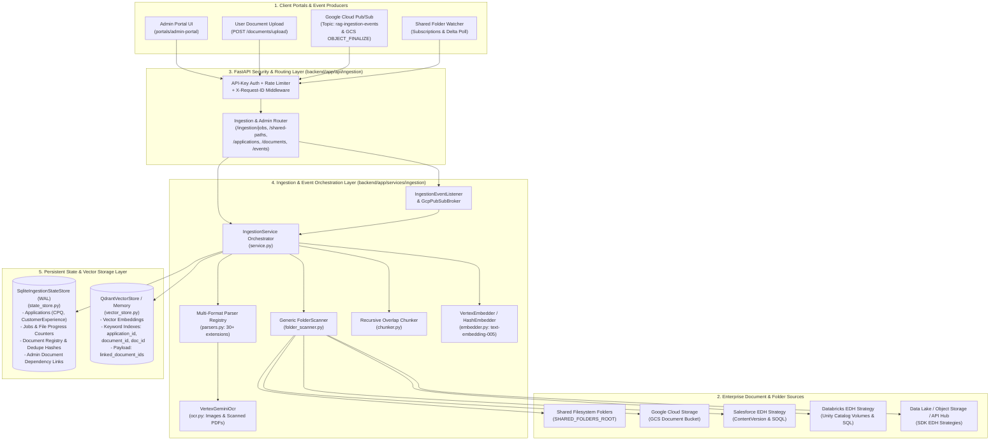
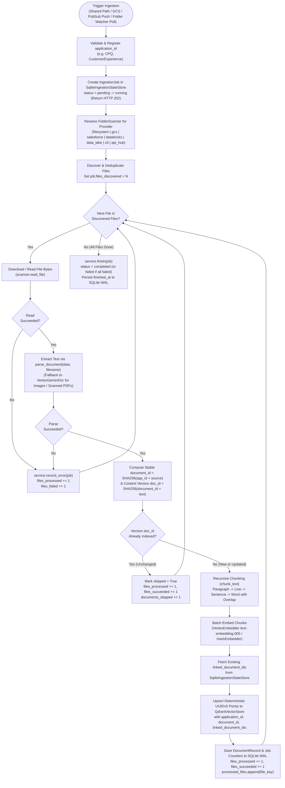
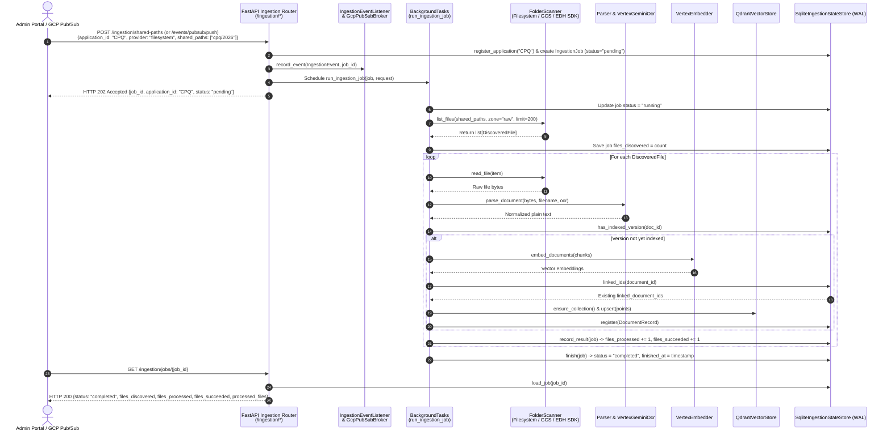
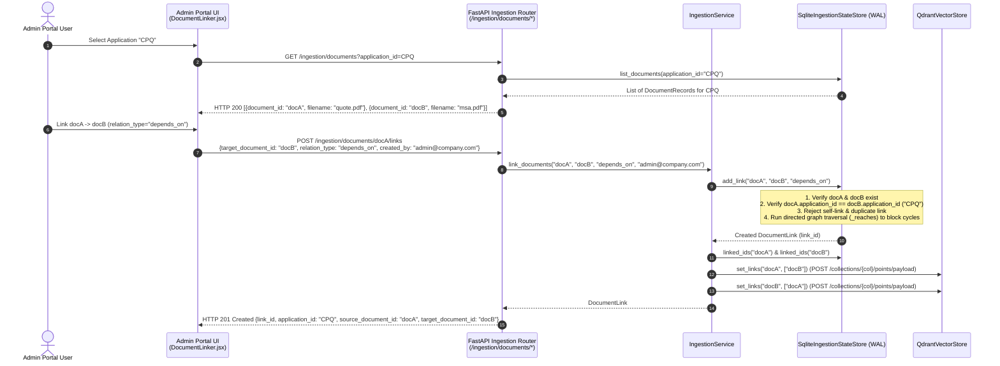

# Phase 1: Enterprise Multi-Application Document Ingestion, Event Listener & Document Dependency Pipeline

**Status:** Implemented and unit-tested to production standards (Backend: **46 passed, 8 skipped** live-credential integration tests; SDK: **54 passed, 10 skipped**).

---

## 1. Goal & Overview

Phase 1 transforms raw enterprise documents and records from **any shared folder or enterprise data hub** (Local/Mounted Shared Folders, Google Cloud Storage, Data Lake, Salesforce, Databricks Unity Catalog Volumes, S3/Object Storage Hub, API Hub) into searchable, application-isolated (`application_id`: `1. CPQ`, `2. CustomerExperience`, etc.) vector chunks in Qdrant—complete with **Google Cloud Pub/Sub event-driven ingestion**, **background file-processing tracking**, **durable SQLite WAL state persistence**, and **Admin Portal document dependency linking**.

---

## 2. Technical Architecture Diagram

### Diagram 1: Phase 1 Enterprise RAG Ingestion & Linking Technical Architecture



---

## 3. End-to-End Ingestion Workflow Diagram

### Diagram 2: Phase 1 End-to-End Document Ingestion & Progress Tracking Workflow



---

## 4. Sequence Diagrams

### Diagram 3: Sequence Diagram 1 — Shared Folder & Google Cloud Pub/Sub Background Ingestion



---

### Diagram 4: Sequence Diagram 2 — Admin Portal Document Dependency Linking & Vector Payload Sync



---

## 5. Components (`backend/app/services/ingestion/`)

| File | Responsibility |
|---|---|
| [parsers.py](../backend/app/services/ingestion/parsers.py) | Extract text across 30+ file extensions (see Supported Formats below) |
| [ocr.py](../backend/app/services/ingestion/ocr.py) | `OcrProvider` protocol + `VertexGeminiOcr` (images and scanned PDFs via Vertex AI Gemini) |
| [chunker.py](../backend/app/services/ingestion/chunker.py) | Recursive splitter (paragraph, line, sentence, word) with word-aligned overlap |
| [embedder.py](../backend/app/services/ingestion/embedder.py) | `HashEmbedder` (dev/test) and `VertexEmbedder` (Vertex AI `text-embedding-005` REST) |
| [vector_store.py](../backend/app/services/ingestion/vector_store.py) | `InMemoryVectorStore` and `QdrantVectorStore` (REST, with `application_id` & `document_id` indexes and payload link sync) |
| [folder_scanner.py](../backend/app/services/ingestion/folder_scanner.py) | Generic `FolderScanner` across `filesystem`, `gcs`, `salesforce`, `databricks`, `data_lake`, `object_storage_hub`, and `api_hub` |
| [event_listener.py](../backend/app/services/ingestion/event_listener.py) | `IngestionEventListener` (webhook push event handler + shared-folder watcher subscriptions with delta file-fingerprint detection) |
| [pubsub.py](../backend/app/services/ingestion/pubsub.py) | `GcpPubSubBroker` & `InMemoryPubSubBroker` (Google Cloud Pub/Sub Publisher, Push Subscription receiver with native GCS `OBJECT_FINALIZE` decoding, and Pull/Ack Subscriber) |
| [state_store.py](../backend/app/services/ingestion/state_store.py) | `SqliteIngestionStateStore` (durable WAL-mode SQLite persistence for jobs, applications, indexed documents, content deduplication, and Admin Portal document links across restarts) |
| [registry.py](../backend/app/services/ingestion/registry.py) | `DocumentRegistry`, `ApplicationInfo`, `DocumentRecord`, `DocumentLink`, and multi-application validation |
| [service.py](../backend/app/services/ingestion/service.py) | `IngestionService` orchestration, idempotency, `JobStore`, and `link_documents` / `unlink_documents` |
| [factory.py](../backend/app/services/ingestion/factory.py) | Builds `IngestionService` from application settings |

API Router: [ingestion.py](../backend/app/api/ingestion/ingestion.py) | Request/Response Models: [ingestion.py](../backend/app/models/request/ingestion.py)

---

## 6. Supported Formats

| Type | Extensions | Extraction Method |
|---|---|---|
| Text & Config | `.txt .md .markdown .log .rst .ini .cfg .yaml .yml .toml .tex` | UTF-8 / UTF-16 / CP1252 decoding + whitespace normalization |
| Tabular | `.csv .tsv` | Delimiter auto-detection; each row formatted as `header: value \| header: value` |
| Structured | `.json .jsonl .ndjson .xml` | Structured text normalization |
| Web / Email / RTF | `.html .htm .eml .rtf` | Script/style stripping, email header + body extraction, RTF control stripping |
| Office | `.docx .pptx .xlsx` | Pure standard-library XML extraction per paragraph, slide, or worksheet |
| PDF | `.pdf` | `pypdf` digital text extraction with automatic fallback to `VertexGeminiOcr` for scanned PDFs |
| Images | `.png .jpg .jpeg .webp .gif .bmp .tif .tiff .heic` | Multimodal OCR via `VertexGeminiOcr` (`OCR_PROVIDER=vertex`) |

---

## 7. Phase 1 REST API Reference

### A. Multi-Application Management (`CPQ`, `CustomerExperience`, etc.)
- **`GET /ingestion/applications`** — List registered applications.
- **`POST /ingestion/applications` (`201 Created`)** — Register or update an application tenant:
  ```json
  {
    "application_id": "CPQ",
    "name": "Configure, Price, Quote",
    "description": "Pricing rules, product catalogs, and quote templates"
  }
  ```

### B. Background Shared-Folder & Batch Ingestion Jobs
- **`POST /ingestion/shared-paths` (`202 Accepted`)** — Scan any shared folder in the background across any provider (`filesystem`, `gcs`, `data_lake`, `salesforce`, `databricks`, `object_storage_hub`, `api_hub`, `memory`):
  ```json
  {
    "application_id": "CPQ",
    "provider": "filesystem",
    "shared_paths": ["cpq/2026", "contracts"],
    "zone": "raw",
    "limit": 200
  }
  ```
- **`POST /ingestion/jobs` (`202 Accepted`)** — Queue a job for `source_type: "shared_path" | "gcs" | "salesforce" | "salesforce_path"`.
- **`GET /ingestion/jobs?application_id=CPQ`** & **`GET /ingestion/jobs/{job_id}`** — Inspect live file-processing counters:
  - `files_discovered`, `files_processed`, `files_succeeded`, `files_failed`, `processed_files`
  - `documents_total`, `documents_indexed`, `documents_skipped`, `chunks_indexed`, `errors`, `created_at`, `finished_at`

### C. Event Listener, Folder Watcher & Google Cloud Pub/Sub
- **`POST /ingestion/events/webhook` (`202 Accepted`)** — Direct webhook event listener.
- **`POST /ingestion/events/subscriptions` (`201 Created`)**, **`GET /ingestion/events/subscriptions`**, **`DELETE /ingestion/events/subscriptions/{id}`** — Manage watched shared folders.
- **`POST /ingestion/events/poll`** — Poll watched folders and trigger ingestion jobs only for newly added or modified files.
- **`POST /ingestion/events/pubsub/publish` (`202 Accepted`)** — Publish an `IngestionEvent` to Google Cloud Pub/Sub.
- **`POST /ingestion/events/pubsub/push` (`202 Accepted`)** — Receive Google Cloud Pub/Sub Push Subscription messages (including native GCS `OBJECT_FINALIZE` notifications).
- **`POST /ingestion/events/pubsub/pull`** — Pull pending messages from a Cloud Pub/Sub subscription, queue background jobs, and acknowledge (`ack`).
- **`GET /ingestion/events`** — List recent ingestion events and triggered `job_id`s.

### D. Admin Portal Document Dependency & Linking
- **`GET /ingestion/documents?application_id=CPQ`** — List indexed documents and their `linked_document_ids`.
- **`POST /ingestion/documents/{document_id}/links` (`201 Created`)** — Link two documents within the same `application_id` (`depends_on`, `related`, `attachment_of`, `amends`, `supersedes`, `references`) with cycle detection and immediate Qdrant payload sync.
- **`GET /ingestion/documents/{document_id}/links`** — Inspect `outgoing` and `incoming` links.
- **`DELETE /ingestion/documents/{document_id}/links/{link_id}`** — Remove a document link and sync vector payloads.

---

## 8. Configuration (`backend/.env.local`)

| Variable | Default | Description |
|---|---|---|
| `EMBEDDING_PROVIDER` | `hash` | `hash` (local dev/test) or `vertex` (Vertex AI REST) |
| `EMBEDDING_MODEL` | `text-embedding-005` | Vertex AI embedding model |
| `EMBEDDING_DIMENSIONS` | `768` | Embedding vector dimensionality |
| `VECTOR_STORE` | `memory` | `memory` or `qdrant` |
| `QDRANT_URL` / `QDRANT_API_KEY` | empty | Qdrant endpoint and API key |
| `QDRANT_COLLECTION` | `rag_chunks` | Qdrant collection name |
| `CHUNK_SIZE` / `CHUNK_OVERLAP` | `1000` / `200` | Recursive chunk size and character overlap |
| `OCR_PROVIDER` / `OCR_MODEL` | `none` / `gemini-2.0-flash` | Set `OCR_PROVIDER=vertex` for images & scanned PDFs |
| `SHARED_FOLDERS_ROOT` | `./.shared_folders` | Base directory for `provider="filesystem"` shared folder scans |
| `PUBSUB_PROVIDER` | `memory` | `memory` (local dev/tests) or `gcp` (Google Cloud Pub/Sub REST v1) |
| `PUBSUB_INGESTION_TOPIC` | `rag-ingestion-events` | Cloud Pub/Sub topic name |
| `PUBSUB_INGESTION_SUBSCRIPTION` | `rag-ingestion-sub` | Cloud Pub/Sub pull subscription name |
| `INGESTION_STATE_DB_PATH` | `./.data_lake/ingestion_state.sqlite3` | Durable SQLite WAL database path |
