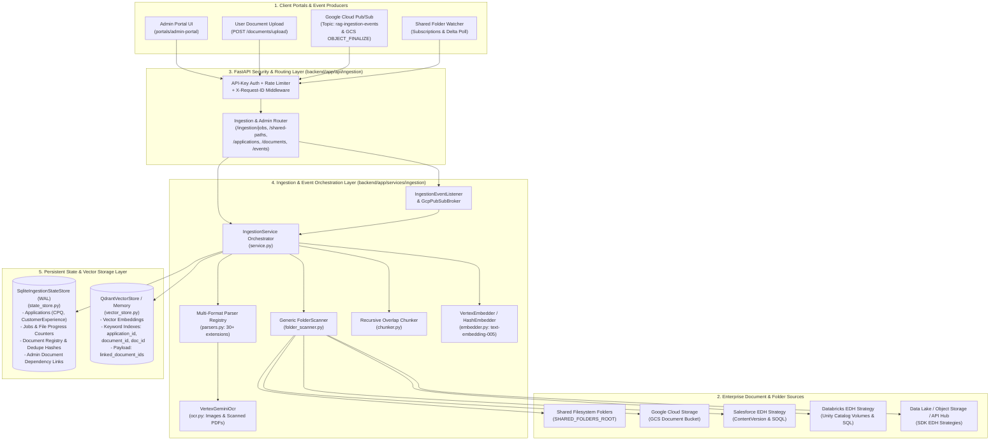

# Phase 1: Technical Architecture

**Parent Index:** [phase1.md](./phase1.md)

---

## 1. Technical Architecture Diagram

### Diagram 1: Phase 1 Enterprise RAG Ingestion & Linking Technical Architecture



---

## 2. Backend Components (`backend/app/services/ingestion/`)

| File | Responsibility |
|---|---|
| [parsers.py](../backend/app/services/ingestion/parsers.py) | Extract text across 30+ file extensions (Text, CSV/TSV, JSON/JSONL/XML, HTML/EML/RTF, DOCX/PPTX/XLSX, PDF, Images) |
| [ocr.py](../backend/app/services/ingestion/ocr.py) | `OcrProvider` protocol + `VertexGeminiOcr` (images and scanned PDFs via Vertex AI Gemini REST) |
| [chunker.py](../backend/app/services/ingestion/chunker.py) | Recursive splitter (paragraph, line, sentence, word) with word-aligned overlap |
| [embedder.py](../backend/app/services/ingestion/embedder.py) | `HashEmbedder` (dev/test) and `VertexEmbedder` (Vertex AI `text-embedding-005` REST) |
| [vector_store.py](../backend/app/services/ingestion/vector_store.py) | `InMemoryVectorStore` and `QdrantVectorStore` (REST, with `application_id` & `document_id` keyword indexes and payload link sync) |
| [folder_scanner.py](../backend/app/services/ingestion/folder_scanner.py) | Generic `FolderScanner` across `filesystem`, `gcs`, `salesforce`, `databricks`, `data_lake`, `object_storage_hub`, and `api_hub` |
| [event_listener.py](../backend/app/services/ingestion/event_listener.py) | `IngestionEventListener` (webhook push event handler + shared-folder watcher subscriptions with delta file-fingerprint detection) |
| [pubsub.py](../backend/app/services/ingestion/pubsub.py) | `GcpPubSubBroker` & `InMemoryPubSubBroker` (Google Cloud Pub/Sub Publisher, Push Subscription receiver with native GCS `OBJECT_FINALIZE` decoding, and Pull/Ack Subscriber) |
| [state_store.py](../backend/app/services/ingestion/state_store.py) | `SqliteIngestionStateStore` (durable WAL-mode SQLite persistence for jobs, applications, indexed documents, content deduplication, and Admin Portal document links across restarts) |
| [registry.py](../backend/app/services/ingestion/registry.py) | `DocumentRegistry`, `ApplicationInfo`, `DocumentRecord`, `DocumentLink`, and multi-application validation (`CPQ`, `CustomerExperience`, custom) |
| [service.py](../backend/app/services/ingestion/service.py) | `IngestionService` orchestration, idempotency, `JobStore`, and `link_documents` / `unlink_documents` |
| [factory.py](../backend/app/services/ingestion/factory.py) | Builds `IngestionService` from application settings |

- **API Router:** [ingestion.py](../backend/app/api/ingestion/ingestion.py)
- **Request/Response Models:** [ingestion.py](../backend/app/models/request/ingestion.py)

---

## 3. Admin Portal UI Architecture (`portals/admin-portal/`)

| File | Responsibility |
|---|---|
| [ApplicationSelector.jsx](../portals/admin-portal/src/components/ApplicationSelector.jsx) | Switch active `application_id` (`1. CPQ`, `2. CustomerExperience`, or register a new application) |
| [SharedFolderIngestionForm.jsx](../portals/admin-portal/src/components/SharedFolderIngestionForm.jsx) | Configure and launch background shared-folder ingestion jobs across any provider |
| [JobsTrackerTable.jsx](../portals/admin-portal/src/components/JobsTrackerTable.jsx) | Live file-processing progress dashboard (`files_discovered`, `files_processed`, `files_succeeded`, `files_failed`, `processed_files`) |
| [DocumentLinker.jsx](../portals/admin-portal/src/components/DocumentLinker.jsx) | Map document dependencies (`depends_on`, `related`, `attachment_of`, `amends`, `supersedes`, `references`) |
| [ingestionApi.js](../portals/admin-portal/src/services/ingestionApi.js) | REST client for `/ingestion/*` endpoints |
| [useIngestionAdmin.js](../portals/admin-portal/src/hooks/useIngestionAdmin.js) | React state and auto-polling hook scoped to the active `application_id` |

---

## 4. Supported Document Formats

| Type | Extensions | Extraction Method |
|---|---|---|
| Text & Config | `.txt .md .markdown .log .rst .ini .cfg .yaml .yml .toml .tex` | UTF-8 / UTF-16 / CP1252 decoding + whitespace normalization |
| Tabular | `.csv .tsv` | Delimiter auto-detection; each row formatted as `header: value \| header: value` |
| Structured | `.json .jsonl .ndjson .xml` | Structured text normalization |
| Web / Email / RTF | `.html .htm .eml .rtf` | Script/style stripping, email header + body extraction, RTF control stripping |
| Office | `.docx .pptx .xlsx` | Pure standard-library XML extraction per paragraph, slide, or worksheet |
| PDF | `.pdf` | `pypdf` digital text extraction with automatic fallback to `VertexGeminiOcr` for scanned PDFs |
| Images | `.png .jpg .jpeg .webp .gif .bmp .tif .tiff .heic` | Multimodal OCR via `VertexGeminiOcr` (`OCR_PROVIDER=vertex`) |

---

## 5. Storage & Vector Payload Schema

### A. Vector Point Payload (`QdrantVectorStore` / `InMemoryVectorStore`)
Every indexed chunk stores:
```json
{
  "application_id": "CPQ",
  "doc_id": "a1b2c3d4e5f60718-9f8e7d6c5b4a3210...",
  "document_id": "a1b2c3d4e5f60718",
  "linked_document_ids": ["f0e1d2c3b4a59687"],
  "source": "shared_path://filesystem/cpq/2026/pricing_policy.txt",
  "source_type": "shared_path",
  "provider": "filesystem",
  "shared_path": "cpq/2026",
  "object_key": "cpq/2026/pricing_policy.txt",
  "zone": "raw",
  "chunk_index": 0,
  "chunk_count": 3,
  "text": "Enterprise CPQ discount tier requires VP approval..."
}
```

### B. SQLite WAL Persistent Tables (`SqliteIngestionStateStore`)
- `applications` (`application_id`, `name`, `description`, `created_at`)
- `documents` (`document_id`, `application_id`, `source`, `filename`, `version_id`, `chunk_count`, `indexed_at`)
- `document_links` (`link_id`, `application_id`, `source_document_id`, `target_document_id`, `relation_type`, `created_by`, `created_at`)
- `ingestion_jobs` (`job_id`, `application_id`, `source_type`, `status`, `files_discovered`, `files_processed`, `files_succeeded`, `files_failed`, `processed_files_json`, `documents_total`, `documents_indexed`, `documents_skipped`, `chunks_indexed`, `errors_json`, `created_at`, `finished_at`)
