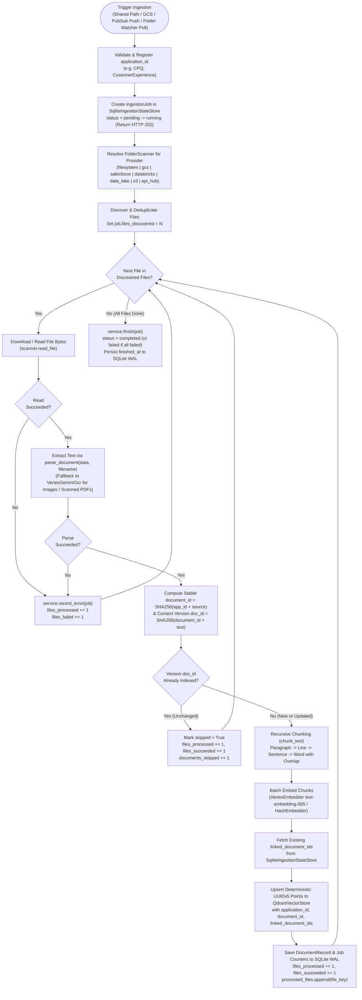

# Phase 1: End-to-End Document Ingestion & Linking Workflow

**Parent Index:** [phase1.md](./phase1.md)

---

## 1. End-to-End Document Ingestion Workflow Diagram

### Diagram 2: Phase 1 End-to-End Document Ingestion & Progress Tracking Workflow

---

## 2. Step-by-Step Ingestion Lifecycle

1. **Application Scoping (`application_id`):**
   - Every ingestion request carries an `application_id` (such as `CPQ` or `CustomerExperience`).
   - `validate_application_id` normalizes the ID and ensures the application is registered in `SqliteIngestionStateStore`.
2. **Job Creation & Background Scheduling (`HTTP 202 Accepted`):**
   - `service.jobs.create(source_type, application_id)` creates a persistent `IngestionJob` in SQLite WAL with `status="pending"` and schedules `run_ingestion_job` on FastAPI's `BackgroundTasks`.
3. **Provider-Specific Folder Discovery (`files_discovered`):**
   - `resolve_folder_scanner(provider)` selects the appropriate scanner:
     - `filesystem`: Recursively walks `SHARED_FOLDERS_ROOT/<path>` (blocking any `../` path traversal) and filters for supported extensions.
     - `gcs`: Lists objects under the prefix in the GCS document bucket (`StorageService.list_objects`).
     - `salesforce`: Uses `AsyncEdhConnector.list_objects` to find `ContentVersion` documents under the shared path prefix.
     - `data_lake` / `databricks` / `object_storage_hub` / `api_hub`: Uses the SDK's `AsyncEdhConnector.list_objects` for that strategy.
   - Sets `job.files_discovered` to the total number of unique files found.
4. **Fault-Isolated Per-File Processing:**
   - Each file is downloaded and parsed inside its own `try / except` block.
   - If a file is unreadable or corrupt, `service.record_error` increments `files_processed` and `files_failed`, records the error in `job.errors`, saves to SQLite, and continues processing the remaining files.
5. **Format-Aware Parsing & Automatic OCR Fallback:**
   - `parse_document(data, filename, ocr)` extracts plain text from 30+ extensions.
   - Digital PDFs are parsed with `pypdf`; if a PDF contains almost no extractable text (< 20 characters) and `OCR_PROVIDER=vertex`, it automatically falls back to `VertexGeminiOcr`.
   - Images (`.png`, `.jpg`, `.jpeg`, `.webp`, `.gif`, `.bmp`, `.tif`, `.tiff`, `.heic`) are sent to `VertexGeminiOcr`.
6. **Idempotent Deduplication & Stable Document Identity:**
   - **`document_id`**: Hash of `(application_id, source_uri)` — remains constant when a document is re-uploaded with updated content.
   - **`doc_id` (`version_id`)**: Hash of `(document_id, normalized_text)`.
   - If `doc_id` is already present in `SqliteIngestionStateStore`, embedding and Qdrant upsert are skipped (`documents_skipped += 1`, `files_processed += 1`, `files_succeeded += 1`).
7. **Recursive Chunking, Batch Embedding & Vector Indexing:**
   - `chunk_text` splits text recursively by paragraphs -> lines -> sentences -> words into `CHUNK_SIZE` (`1000`) with word-aligned `CHUNK_OVERLAP` (`200`).
   - `embedder.embed_documents(chunks)` generates vectors in batches.
   - Chunks are given deterministic UUIDv5 IDs (`uuid5(NAMESPACE, f"{doc_id}:{chunk_index}")`) and upserted into `QdrantVectorStore` (or `InMemoryVectorStore`) with `application_id`, `document_id`, and any existing `linked_document_ids`.
8. **Live Progress Counters (`files_processed`):**
   - After each file, `record_result` updates `files_processed`, `files_succeeded`, `processed_files`, `documents_indexed`, and `chunks_indexed` in SQLite WAL.

---

## 3. Event-Driven Ingestion (Google Cloud Pub/Sub & Folder Watcher)

1. **Google Cloud Pub/Sub Push (`POST /ingestion/events/pubsub/push`):**
   - Receives standard Pub/Sub push envelopes (`{"message": {"data": "<base64>", "attributes": {...}}, "subscription": "..."}`).
   - Automatically decodes both custom RAG ingestion events and **native GCS Bucket Notification (`OBJECT_FINALIZE`)** messages, infers `application_id` from object metadata or path (`documents/<application_id>/...`), and triggers background ingestion.
2. **Google Cloud Pub/Sub Pull (`POST /ingestion/events/pubsub/pull`):**
   - Pulls messages from `PUBSUB_INGESTION_SUBSCRIPTION`, queues background jobs, and acknowledges (`:acknowledge`) the processed `ackId`s.
3. **Shared-Folder Watcher Subscriptions (`POST /ingestion/events/subscriptions` & `POST /ingestion/events/poll`):**
   - Watches registered `(application_id, provider, shared_path)` folders, hashes file fingerprints, and queues ingestion jobs **only for newly added or modified files** since the previous poll.

---

## 4. Admin Portal Document Dependency Linking

When an admin links two documents in the Admin Portal (`POST /ingestion/documents/{document_id}/links`):
- Validates both documents exist and belong to the **same `application_id`** (blocking cross-application links such as `CPQ` -> `CustomerExperience` with HTTP `400`).
- Blocks self-links, duplicate links, and circular dependencies (`A depends_on B -> B depends_on A`) on directed relation types (`depends_on`, `attachment_of`, `amends`, `supersedes`).
- Persists the link in `SqliteIngestionStateStore` and immediately calls `vector_store.set_links(...)` to update `linked_document_ids` on all vector chunks of both documents.
