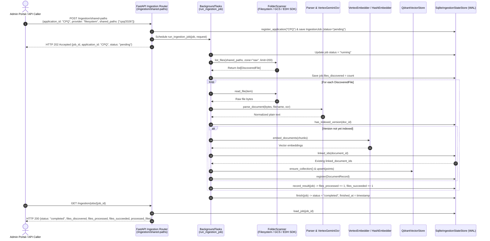
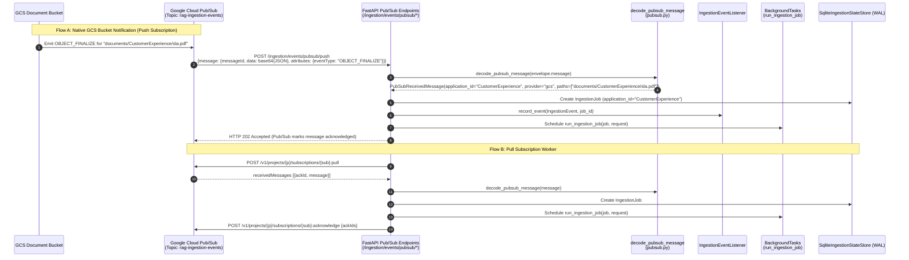
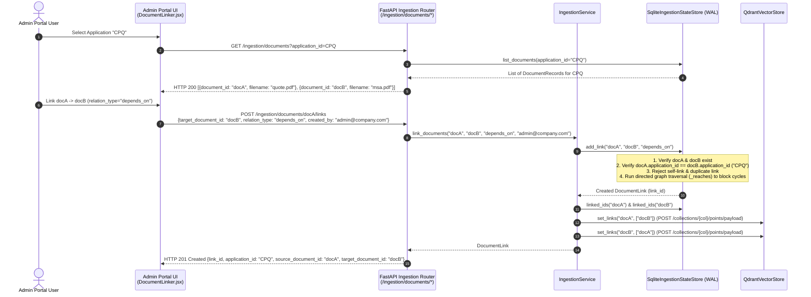
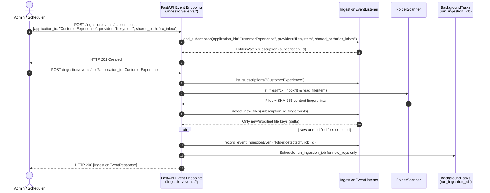

# Phase 1: Sequence Diagrams

**Parent Index:** [phase1.md](./phase1.md)

---

## 1. Sequence Diagram 1 — Shared Folder & Background Ingestion Flow

---

## 2. Sequence Diagram 2 — Google Cloud Pub/Sub Push (`OBJECT_FINALIZE`) & Pull Subscriber Flow

---

## 3. Sequence Diagram 3 — Admin Portal Document Dependency Linking & Vector Payload Sync

---

## 4. Sequence Diagram 4 — Shared Folder Watcher Subscription & Delta Polling Flow

